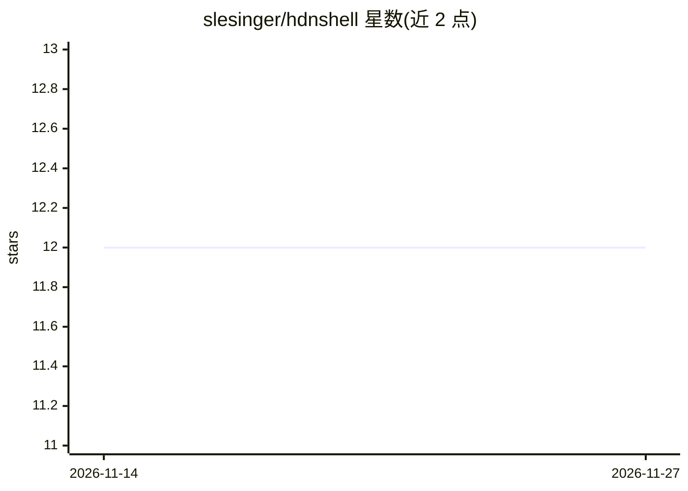

# slesinger/hdnshell

⭐ 12 · Assembly · 推送 2026-08-02 · [GitHub](https://github.com/slesinger/hdnshell) · 个人维护

**C64 复古机的 AI 联网 Shell 与配套服务器应用**

运行在 Retro Replay 卡带上的 Commodore 64 Shell，与 BASIC 并存：卡带内直接处理简化命令（文件管理、磁盘镜像挂载、机器码监视器），BASIC 无法理解的输入转发到用户自建 PC/Mac 上的 HDN Server，提供 AI 聊天、手册搜索、CSDB 访问、虚拟控制台应用（编辑器、浏览器、Telegram、RSS 等），以及可查看屏幕、按键并注入程序的 AI 编码 agent。服务器需 Ultimate 联网硬件，接受任意 OpenAI 兼容端点，无托管服务。

## 筛选速览

| 维度 | 判定 | 备注 |
|---|---|---|
| AI 角色 | `ai-enhanced` | 去掉 AI 部分产品仍成立 |
| 许可风险 | `none` | — |
| 部署形态 | `None` |  |
| 模型依赖 | — | README 未给出锁定关系 |
| 硬件要求 | — | 无带数字的原话,不猜 |
| 安装摩擦 | `low` | 无编译、无系统依赖或容器化 |
| 成熟度 | — | 结构信号不足 |

## 能力要点

- BASIC 保留不动，Shell 以卡带楔入方式与 READY. 提示符并存
- AI 编码 agent 可查看屏幕、按键、向真实机器注入编译后的程序
- HDN Server 本地自建，支持任意 OpenAI 兼容 LLM 端点
- 服务器端虚拟控制台应用集：编辑器、浏览器、Telegram、RSS、Wikipedia

## 适用场景

- 在 C64 上用简化命令进行文件管理与磁盘操作
- 通过终端提示符直接与 AI 聊天获取帮助
- 用 AI 编码 agent 协助开发并注入程序到真机
- 在复古机上浏览 CSDB、RSS、Wikipedia 等网络内容

## 场景标签

`聊天机器人` `编码 Agent` `AI 助手` · 领域:编码与开发

## 证据(README 行号)

> L5: HDN Shell RR turns a Retro Replay cartridge on your C64 Ultimate into an AI-enabled, network-connected shell that li
> L19: - **Your machine, your server:** run the HDN Server locally on your own PC or Mac — no hosted service, no account, 

## 星数曲线

2026-11-14 12 → 2026-11-27 12（+0）

---
*卡片 v1 · prompt 1.4 · 生成 2026-11-18 · 置信度 high · 依据 README sha `768aabffcaaa` · [字段定义](../../DATASET.md)*
