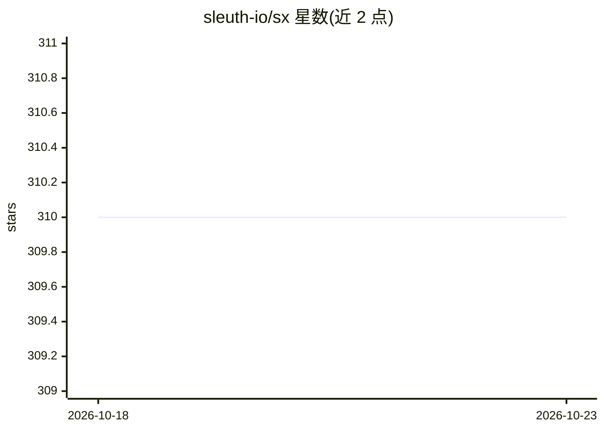

# sleuth-io/sx

⭐ 310 · Go · Apache-2.0 · 推送 2026-10-22 · [GitHub](https://github.com/sleuth-io/sx) · [官网](https://sleuth-io.github.io/sx/) · 组织维护

**团队间共享分发 AI 技能资产的包管理工具**

面向团队的 AI 资产（skills、rules、agents、commands、hooks、MCP servers、plugins）管理与分发工具，采用 npm 式 manifest+lock 机制。vault 可放在 Dropbox/Google Drive 等同步文件夹、git 仓库或 Skills.new 服务，无需服务器与账号；支持按 org/repo/path/team/bot/user 六种作用域安装到各 AI 客户端，并提供采用统计与审计流。提供桌面 App（macOS/Windows/Linux）与 CLI 两种前端，也可作为 Go 库嵌入。

## 筛选速览

| 维度 | 判定 | 备注 |
|---|---|---|
| AI 角色 | `ai-ecosystem` | LLM/agent 周边工具 |
| 许可风险 | `permissive` | Apache-2.0 |
| 部署形态 | `self-host` | docker 或自建部署 |
| 模型依赖 | — | README 未给出锁定关系 |
| 硬件要求 | — | 无带数字的原话,不猜 |
| 安装摩擦 | `low` | 无编译、无系统依赖或容器化 |
| 成熟度 | — | 结构信号不足 |

## 能力要点

- 同步文件夹/git/Skills.new 多种 vault 分发模式，零基础设施
- org/repo/path/team/bot/user 六级作用域安装
- manifest（sx.toml）+ lock 文件 + JSONL 审计/用量流
- 每个 vault 自动生成 Claude Code / Codex 插件市场清单

## 适用场景

- 团队把 skills 和 agents 一次定义、安装到所有人使用的 AI 工具
- 通过共享文件夹让非技术同事同步 AI 技能
- 追踪团队内技能采用率与变更审计
- 把 agent 及其依赖打包为可移植定义，跨客户端分发

## 场景标签

`提示工程` · 领域:Agent 开发

## 证据(README 行号)

> L31: AI assets — skills, MCPs, agents, rules, commands, hooks — usually live inside a single Git repo. The moment you wa
> L105: ```bash
> L124: **Use your vault from claude.ai or chatgpt.com** — expose it as an MCP

## 星数曲线



2026-10-18 310 → 2026-10-23 310（+0）


---
*卡片 v1 · prompt 1.4 · 生成 2026-10-21 · 置信度 mid · 依据 README sha `916dabeededa` · [字段定义](../../DATASET.md)*
