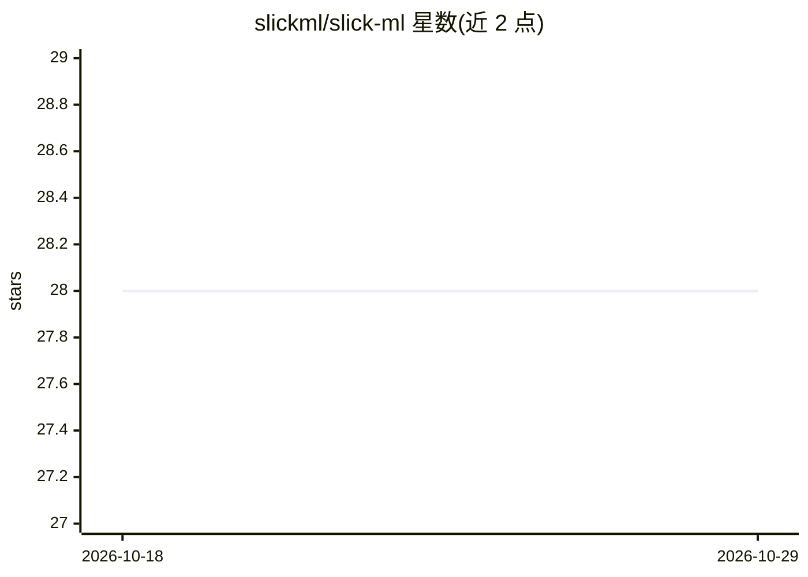

# slickml/slick-ml

⭐ 28 · Python · MIT · 推送 2026-07-20 · [GitHub](https://github.com/slickml/slick-ml) · [官网](https://www.docs.slickml.com) · 组织维护

**面向表格数据的 Python 机器学习库：特征选择、调参、评估**

开源 Python 机器学习库，面向数据科学家的表格数据任务：基于 XGBoost 的特征选择（含交叉验证与频率可视化）、贝叶斯超参数优化、XGBoostCV/GLMNetCV 分类器训练（含特征重要性与 SHAP 可视化），以及二分类/回归指标可视化。核心理念是以梯度提升与广义线性模型覆盖表格数据任务，用少量代码快速原型化，并可通过 ZenML、BentoML、Prefect 等模型服务框架投入生产。需要 Python>=3.9,<3.13 与 Fortran 编译器。

## 筛选速览

| 维度 | 判定 | 备注 |
|---|---|---|
| AI 角色 | `ai-native` | 本体是模型或模型工具 |
| 许可风险 | `permissive` | MIT |
| 部署形态 | `library` | 以包/库形式分发 |
| 模型依赖 | — | README 未给出锁定关系 |
| 硬件要求 | — | 无带数字的原话,不猜 |
| 安装摩擦 | `medium` | 含编译或系统依赖之一 |
| 成熟度 | — | 结构信号不足 |

## 能力要点

- XGBoost 特征选择管线内嵌交叉验证与可视化
- 贝叶斯优化进行超参数调优
- XGBoostCV/GLMNetCV 训练并输出 SHAP 可视化
- 二分类多阈值与回归指标可视化

## 适用场景

- 快速为表格数据任务做特征选择与模型原型
- 可视化比较分类/回归模型评估指标
- 调优后的模型经由模型服务框架部署

## 场景标签

 · 领域:机器学习/数据科学

## 证据(README 行号)

> L28: **SlickML** is an open-source machine learning library written in Python aimed at accelerating the
> L33: linear models 1 . SlickML provides Data Scientists

## 星数曲线

2026-10-18 28 → 2026-10-29 28（+0）

---
*卡片 v1 · prompt 1.4 · 生成 2026-10-26 · 置信度 high · 依据 README sha `69bae32c99db` · [字段定义](../../DATASET.md)*
