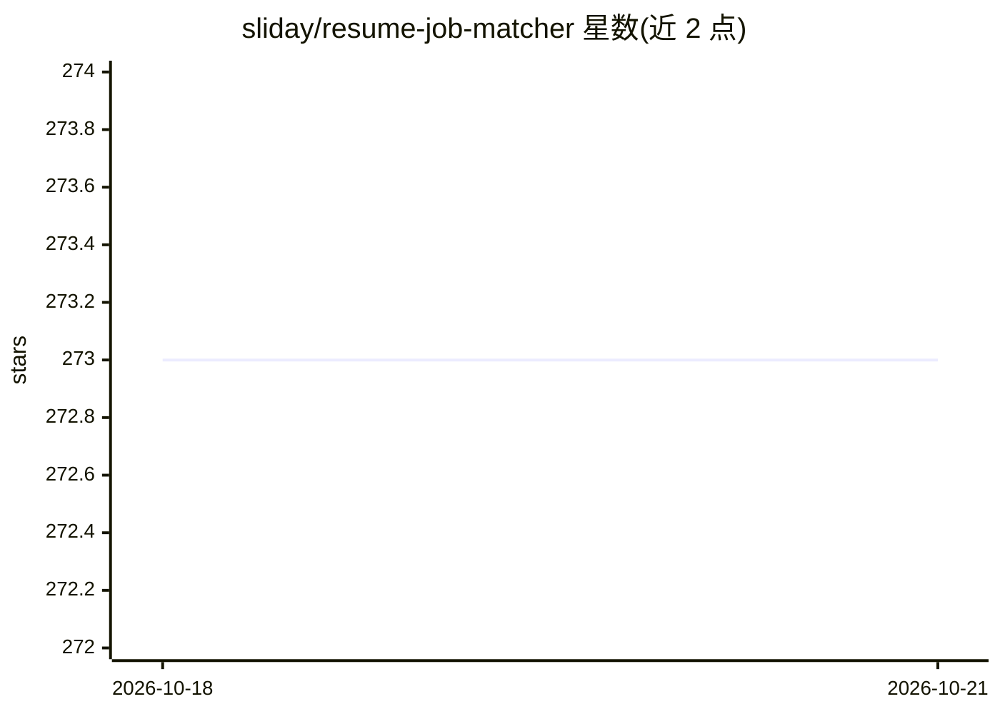

# sliday/resume-job-matcher

⭐ 273 · TypeScript · 推送 2026-08-31 · [GitHub](https://github.com/sliday/resume-job-matcher) · 个人维护

**AI 简历筛选 CLI：硬性门槛先淘汰，每项评分引用简历原文**

TypeScript 命令行工具，将一个文件夹内的简历 PDF 与职位描述比对，输出面试建议。筛选按漏斗进行：可选的嵌入预过滤（余弦相似度取前 n 份，缓存按简历内容键控）、从职位描述提取硬性约束做通过/淘汰判定（引用淘汰所依据的简历片段）、幸存者按 7 项准则在 0-4 锚定量表上评分且必须先引用证据原文，并按权重生成邀请或拒信邮件。支持 Claude、GPT 与 OpenRouter 三种模式，单一 API key 即可运行。已知限制：跨模型评分方差显著、无 OCR（扫描件需用附带的传统 Python 实现）。

## 筛选速览

| 维度 | 判定 | 备注 |
|---|---|---|
| AI 角色 | `ai-native` | 本体是模型或模型工具 |
| 许可风险 | `none` | — |
| 部署形态 | `library` | 以包/库形式分发 |
| 模型依赖 | locked-api |  |
| 硬件要求 | — | 无带数字的原话,不猜 |
| 安装摩擦 | `low` | 无编译、无系统依赖或容器化 |
| 成熟度 | `idea` | |

## 能力要点

- 硬约束门槛先于评分淘汰，并引用简历原文片段
- 7 项准则锚定量表评分，每项评分前必须引用证据
- 嵌入预过滤按简历内容缓存，候选人只嵌入一次
- 按任务输出邀请/拒信邮件、改进版职位描述与成本统计

## 适用场景

- 招聘方批量筛选简历 PDF 并决定面试名单
- 用硬性约束（工作许可、执照、驻地）先淘汰不合格候选人
- 大规模候选人池中先用嵌入预过滤降低 LLM 调用成本

## 场景标签

 · 领域:招聘/人力资源工具

## 证据(README 行号)

> L5: **Resume Job Matcher** screens a folder of resume PDFs against a job description and tells you who to interview. It 
> L10: 2. **Gate**: hard constraints from the job description (work authorization, on-site requirement, licences) become p
> L11: 3. **Score**: survivors are rated per criterion on an anchored 0-4 scale, and every rating quotes the evidence behi

## 星数曲线

2026-10-18 273 → 2026-10-21 273（+0）

---
*卡片 v1 · prompt 1.4 · 生成 2026-10-22 · 置信度 mid · 依据 README sha `0c5699693017` · [字段定义](../../DATASET.md)*
