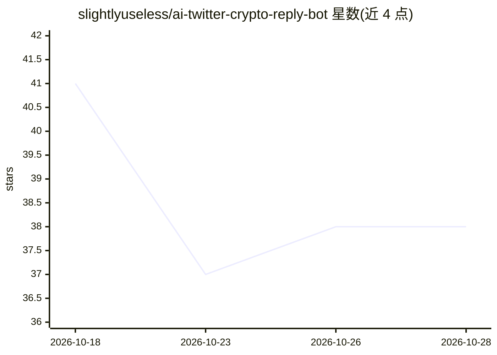

# slightlyuseless/ai-twitter-crypto-reply-bot

⭐ 38 · JavaScript · MIT · 推送 2026-06-25 · [GitHub](https://github.com/slightlyuseless/ai-twitter-crypto-reply-bot) · 个人维护

**自动回复 Crypto Twitter 的 AI 回复机器人（Claude/OpenAI）**

面向加密货币 X (Twitter) 的自动回复机器人框架：实时推文流（RapidLaunch WebSocket 或 X List 轮询）喂给确定性评分引擎决定回复对象，LLM（Anthropic Claude 或 OpenAI）按可配置 persona 生成回复文本，再由 Playwright 驱动已登录浏览器会话发帖。监督器支持崩溃自动重启、调用编码 agent 自修复代码、并基于互动数据做有界自调优。需要 Node.js ≥ 22.5、RapidLaunch 账号与一个 LLM key；README 明确警告自动发帖可能违反 X 服务条款。

## 筛选速览

| 维度 | 判定 | 备注 |
|---|---|---|
| AI 角色 | `ai-native` | 本体是模型或模型工具 |
| 许可风险 | `permissive` | MIT |
| 部署形态 | `library` | 以包/库形式分发 |
| 模型依赖 | locked-api |  |
| 硬件要求 | — | 无带数字的原话,不猜 |
| 安装摩擦 | `low` | 无编译、无系统依赖或容器化 |
| 成熟度 | — | 结构信号不足 |

## 能力要点

- 评分引擎确定性决定回复对象，LLM 仅生成文本，支出可预测
- Anthropic/OpenAI 双 provider 抽象，支持 vision 与切换模型
- Playwright 人性化浏览器发帖，dry run 模式可先不发送
- supervisor 支持自动重启、编码 agent 自修复与基于数据的有界调参

## 适用场景

- 我想让一个 AI persona 账号在 Crypto Twitter 上持续互动
- 先用 dry run 模式验证回复策略再实际发帖
- 让 agent 基于互动漏斗数据自动微调发帖节奏

## 场景标签

`浏览器自动化` · 领域:效率与自动化

## 证据(README 行号)

> L6: It watches a live tweet feed, scores every tweet deterministically, lets an LLM
> L7: (Claude **or** OpenAI) write a witty reply in a persona you control, and posts it
> L45: - **Generation** (`bot/generation/`): `persona.js` is the character;

## 星数曲线

2026-10-18 41 → 2026-10-28 38（-3）

---
*卡片 v1 · prompt 1.4 · 生成 2026-10-25 · 置信度 high · 依据 README sha `468924693a89` · [字段定义](../../DATASET.md)*
