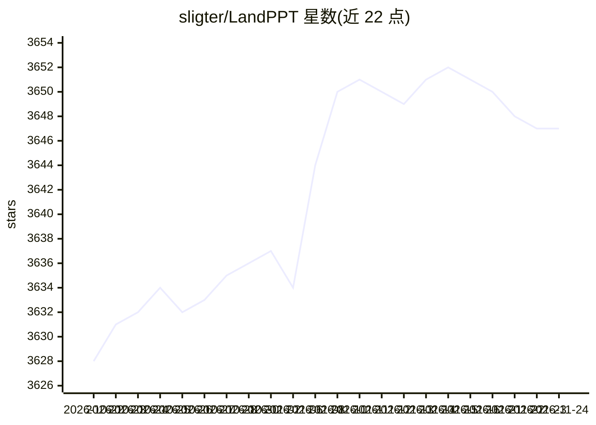

# sligter/LandPPT

⭐ 3,650 · Python · NOASSERTION · 推送 2026-11-20 · [GitHub](https://github.com/sligter/LandPPT) · [官网](https://landppt.com) · 组织维护 · 中文 README

**基于大语言模型的 PPT 生成平台：文档/主题转演示文稿**

以「主题或文档 → 大纲 → HTML PPT → 讲稿/配音/导出」为工作流的 Web 平台。用户输入主题或上传 PDF/Word/Excel/PPT/Markdown/图片，经大纲编辑、可选深度研究、AI 配图与并行生成产出幻灯片，支持侧边栏 AI 对话编辑、Edge-TTS 讲解音频、1080p 讲解视频，以及 PDF/HTML/PPTX/图片/DOCX/Markdown 多格式导出。本地默认 SQLite 即可运行；标准可编辑 PPTX 导出需商业许可的 Apryse License Key；FastAPI 实现，提供 Docker 单容器与 Compose 部署及 OpenAI 兼容 REST API。

## 筛选速览

| 维度 | 判定 | 备注 |
|---|---|---|
| AI 角色 | `ai-native` | 本体是模型或模型工具 |
| 许可风险 | `none` | NOASSERTION |
| 部署形态 | `self-host` | docker 或自建部署 |
| 模型依赖 | local-ok | 支持本地模型 |
| 硬件要求 | — | 无带数字的原话,不猜 |
| 安装摩擦 | `low` | 无编译、无系统依赖或容器化 |
| 成熟度 | — | 结构信号不足 |

## 能力要点

- 主题/文档到完整 PPT 一键并行生成，四阶段工作流（需求确认→大纲→任务追踪→生成）
- 按角色（大纲/幻灯片/编辑/模板/讲稿）路由不同模型以控制成本
- 三源配图：本地图库/网络图库（Pixabay、Unsplash）/AI 生成
- 多格式导出与一键公开分享链接（含讲解音频与字幕）

## 适用场景

- 把长文档或报告快速转成结构化演示文稿
- 教学课件与工作汇报的自动化制作
- 接入 API 在脚本/CI 中批量生成 PPT

## 场景标签

`语音合成` · 领域:内容生成

## 证据(README 行号)

> L19: **一句话：** LandPPT 是基于大语言模型的智能演示文稿平台——输入主题或上传文档，自动生成可编辑的专业 PPT，并支持讲稿、讲解视频与多格式导出。
> L73: - OpenAI GPT、Anthropic Claude、Google Gemini、Azure OpenAI
> L144: |基础生成（大纲 / HTML PPT）|至少一个 AI Provider Key|**必需**|

## 星数曲线

2026-10-22 3,628 → 2026-11-24 3,647（+19）

---
*卡片 v1 · prompt 1.4 · 生成 2026-11-23 · 置信度 high · 依据 README sha `08eb4e006539` · [字段定义](../../DATASET.md)*
