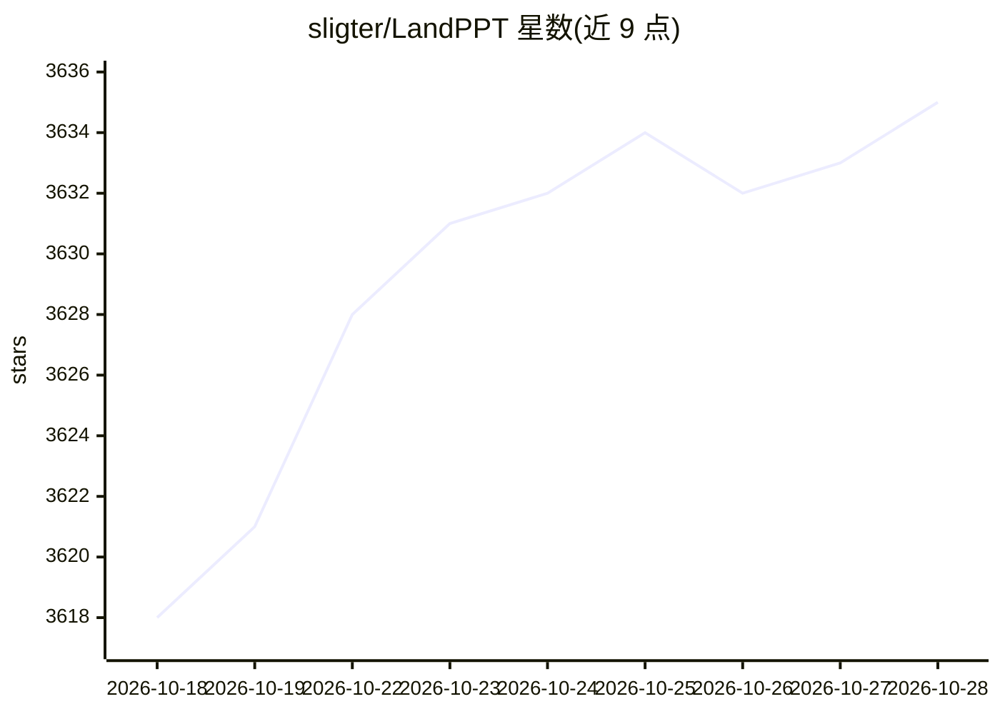

# sligter/LandPPT

⭐ 3,635 · Python · NOASSERTION · 推送 2026-10-27 · [GitHub](https://github.com/sligter/LandPPT) · [官网](https://landppt.com) · 个人维护 · 中文 README

**基于 LLM 的 PPT 自动生成平台：主题或文档一键变演示文稿**

面向最终用户的 Web 演示文稿生成平台：输入主题或上传 PDF/Word/Markdown/Excel/PPT 文档，经大纲规划、并行生成 HTML 幻灯片、配图与讲稿，导出 PDF/HTML/PPTX/图片/DOCX 等格式，并可生成 Edge-TTS 逐页讲解视频。支持 OpenAI/Claude/Gemini/Azure 及 OpenAI 协议接口（DeepSeek、Qwen 等），可接 Ollama 本地推理，按角色路由模型。模板包支持从 PPTX 导入或 AI 创建；标准可编辑 PPTX 导出依赖 Apryse 商业许可，图片型 PPTX 不依赖。提供 uv/pip/Docker/Compose 多种部署方式，本地默认 SQLite。

## 筛选速览

| 维度 | 判定 | 备注 |
|---|---|---|
| AI 角色 | `ai-native` | 本体是模型或模型工具 |
| 许可风险 | `none` | NOASSERTION |
| 部署形态 | `self-host` | docker 或自建部署 |
| 模型依赖 | local-ok | 支持本地模型 |
| 硬件要求 | — | 无带数字的原话,不猜 |
| 安装摩擦 | `low` | 无编译、无系统依赖或容器化 |
| 成熟度 | — | 结构信号不足 |

## 能力要点

- 主题/文档 → 大纲 → HTML PPT → 讲稿/配音/多格式导出的 AI 工作流
- 多提供商接入：OpenAI/Claude/Gemini/Azure 及 OpenAI 协议接口、Ollama 本地模型
- 快速模式模板包：AI 生成内容后自动匹配版式填充 SVG，支持 PPTX 导入与 AI 创建
- Edge-TTS 讲稿配音与 1080p 讲解视频导出（需 ffmpeg）

## 适用场景

- 把工作汇报、教学课件的主题或文档快速生成 PPT
- 需要讲稿、配音讲解视频和公开分享链接的演示场景
- 通过 Ollama 实现无外部大模型 API 的本地部署生成

## 场景标签

`AI 写作` · 领域:内容生成

## 证据(README 行号)

> L19: **一句话：** LandPPT 是基于大语言模型的智能演示文稿平台——输入主题或上传文档，自动生成可编辑的专业 PPT，并支持讲稿、讲解视频与多格式导出。
> L58: LandPPT 将「写大纲 → 做版式 → 配图 → 写讲稿 → 导出」整合成一条 AI 工作流：
> L61: 2. **规划**：生成可编辑大纲，可选深度研究补充最新信息

## 星数曲线

2026-10-18 3,618 → 2026-10-28 3,635（+17）

---
*卡片 v1 · prompt 1.4 · 生成 2026-10-21 · 置信度 high · 依据 README sha `69d73f71b602` · [字段定义](../../DATASET.md)*
