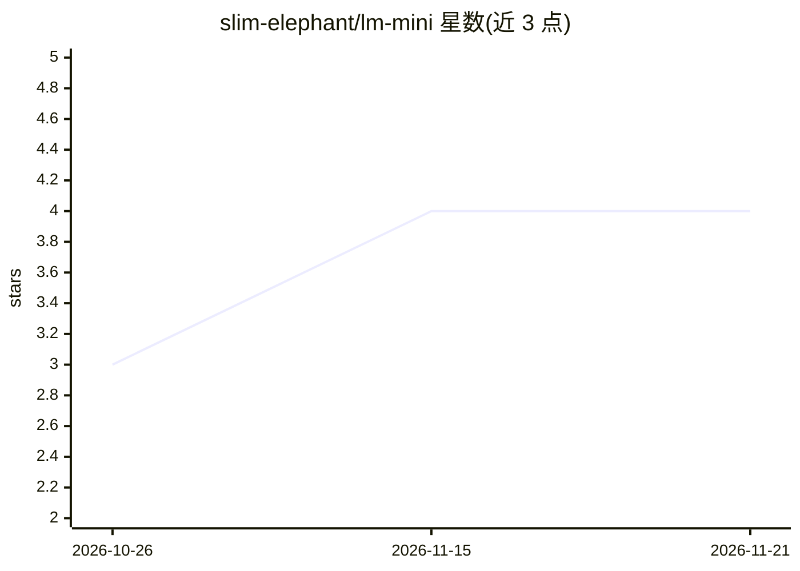

# slim-elephant/lm-mini

⭐ 4 · Dart · MIT · 推送 2026-11-20 · [GitHub](https://github.com/slim-elephant/lm-mini) · [官网](https://lmmini.com) · 个人维护

**手机/桌面多端本地 AI 聊天客户端，连接 LM Studio 与 Ollama**

Flutter 编写的开源聊天客户端，连接局域网内 LM Studio、Ollama、oMLX、Jan、Unsloth 等 OpenAI 兼容服务器，并支持 llama.cpp/MLX 端侧模型。覆盖会话（角色卡导入、iCloud 同步、多模态附件）、工具（SearXNG、MCP）、语音（Whisper 转写、Kokoro/Piper 端侧合成）与图像生成（AUTOMATIC1111、ComfyUI、端侧 Stable Diffusion）。本仓库为开放核心快照：免费功能完整可构建，Pro 功能以 stub 形式存在，需从 App Store/Google Play 获取官方应用。构建需 Flutter SDK 及自行配置 Firebase。

## 筛选速览

| 维度 | 判定 | 备注 |
|---|---|---|
| AI 角色 | `ai-native` | 本体是模型或模型工具 |
| 许可风险 | `permissive` | MIT |
| 部署形态 | `None` |  |
| 模型依赖 | local-ok | 支持本地模型 |
| 硬件要求 | — | 无带数字的原话,不猜 |
| 安装摩擦 | `low` | 无编译、无系统依赖或容器化 |
| 成熟度 | — | 结构信号不足 |

## 能力要点

- 连接 LM Studio、Ollama、oMLX、Jan、Unsloth 等 OpenAI 兼容服务器，含 USB 直连与 Wi-Fi 自动发现
- 端侧推理：内置 GGUF 起步模型、Apple Intelligence、端侧 Whisper 语音转写与 Stable Diffusion 图像生成
- SillyTavern 角色卡导入、SearXNG 搜索与 MCP 服务器工具
- Arena 模式对比多模型回答，支持 Apple Watch 伴侣与 Siri/快捷指令

## 适用场景

- 在手机或手表上通过 Wi-Fi/USB 与本地运行的自有模型聊天
- 多模型并排竞速比较回答质量
- 端侧离线使用语音对话与图像生成

## 场景标签

`聊天机器人` `图像生成` `语音识别` `语音合成` · 领域:对话与助手

## 证据(README 行号)

> L14: Chat with local and on-device AI from your phone, tablet, watch or desktop.
> L16: LM Mini is a Flutter chat client for LM Studio, Ollama, oMLX, Jan, Unsloth and
> L21: ## Open core

## 星数曲线

2026-10-26 3 → 2026-11-21 4（+1）

---
*卡片 v1 · prompt 1.4 · 生成 2026-11-21 · 置信度 high · 依据 README sha `3da99121b3c9` · [字段定义](../../DATASET.md)*
