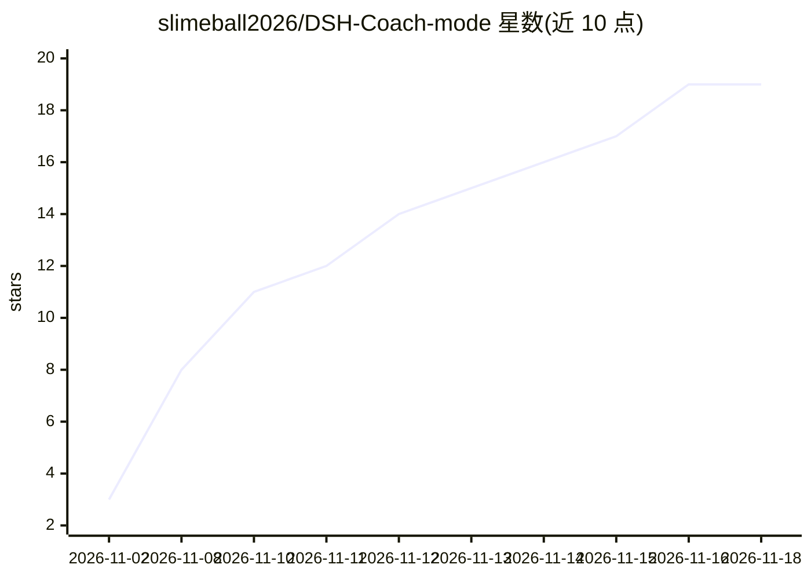

# slimeball2026/DSH-Coach-mode

⭐ 19 · JavaScript · MIT · 推送 2026-11-16 · [GitHub](https://github.com/slimeball2026/DSH-Coach-mode) · 个人维护 · 中文 README

**DeepSeek Harness 插件包：让 AI 以状态机方式带用户动手学工具**

「教练模式」是 DeepSeek Harness（DSH）的 agent preset 插件包，由 slimeball 与 DeepSeek 模型协作开发。它以代码内状态机约束 AI 教学：一次只给一步、结论必须经工具提交证据、write/edit 在工作区被确定性拒绝以防代做；支持安装分支、同会话回退、暂停恢复、检索缓存、进度摘要与成本控制。给希望在 DSH 中获得"不代做"式教学的用户使用。限制：仅同会话、无 UI/slash 命令、截图仅 Windows 有后端、依赖 DSH 插件 API。

## 筛选速览

| 维度 | 判定 | 备注 |
|---|---|---|
| AI 角色 | `ai-ecosystem` | LLM/agent 周边工具 |
| 许可风险 | `permissive` | MIT |
| 部署形态 | `None` |  |
| 模型依赖 | locked-api |  |
| 硬件要求 | — | 无带数字的原话,不猜 |
| 安装摩擦 | `low` | 无编译、无系统依赖或容器化 |
| 成熟度 | — | 结构信号不足 |

## 能力要点

- 阶段、前置条件、证据失效、失败阈值等由插件持有，提示词只负责表达
- write/edit 在工作区被确定性拒绝，实现"不代做"
- 9 个教练工具、11 个相位、stateVersion 12、单测 243
- 暂停/恢复、同会话回退、检索缓存、每步检索上限等预算控制

## 适用场景

- 让 AI 带我一步步自己学会 Git 等工具而不被代做
- 要求每步操作经截图/文件/报错核查后才进入下一步
- 在 DeepSeek Harness 中用带硬约束的教学模式会话

## 场景标签

 · 领域:AI 客户端插件/教学

## 证据(README 行号)

> L7: 「教练模式」是 **DeepSeek Harness** 的一个 agent preset（插件包）。装好后新建会话时，模式列表里会多出一个「教练模式」。
> L9: 它和普通助手的区别不在提示词写得多好，而在**状态机长在代码里**：一次只给一步、必须核查、不许代做、进度和证据都落在会话日志里。模型想跳到下一步，得先让插件校验通过。
> L132: **要求**：Node 24.x（实测 24.21.0）、DeepSeek Harness 0.2.2-rc.1。

## 星数曲线

2026-11-02 3 → 2026-11-18 19（+16）

---
*卡片 v1 · prompt 1.4 · 生成 2026-11-18 · 置信度 high · 依据 README sha `eb43762b3de8` · [字段定义](../../DATASET.md)*
