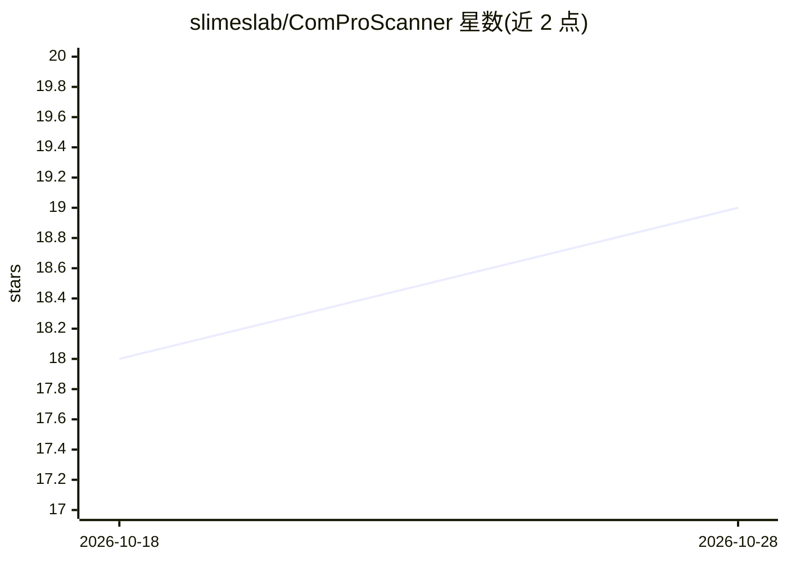

# slimeslab/ComProScanner

⭐ 20 · Python · MIT · 推送 2026-08-11 · [GitHub](https://github.com/slimeslab/ComProScanner) · [官网](https://slimeslab.github.io/ComProScanner/) · 组织维护

**材料学文献中提取组成-性能数据的 Python 多智能体框架**

面向材料信息学研究者与数据库构建者的 Python 包：从科学文献自动提取组成-性能关系数据。工作流分元数据检索、全文采集（Elsevier/Springer/Wiley TDM API、IOP SFTP、本地 PDF）、LLM 智能体结构化信息抽取（基于 CrewAI）、数据评估与可视化四阶段。支持 RAG 上下文检索与知识图谱生成（Neo4j 可选）。需 Python 3.12/3.13、出版商 TDM API key 与 LLM API key。

## 筛选速览

| 维度 | 判定 | 备注 |
|---|---|---|
| AI 角色 | `ai-native` | 本体是模型或模型工具 |
| 许可风险 | `permissive` | MIT |
| 部署形态 | `library` | 以包/库形式分发 |
| 模型依赖 | — | README 未给出锁定关系 |
| 硬件要求 | — | 无带数字的原话,不猜 |
| 安装摩擦 | `low` | 无编译、无系统依赖或容器化 |
| 成熟度 | — | 结构信号不足 |

## 能力要点

- 从文本、表格和图中提取组成-性能数据
- 多出版商支持（Elsevier/Springer/Wiley/IOP/本地 PDF）
- 基于 CrewAI 的多智能体抽取与 RAG 上下文检索
- 语义与 LLM 智能体两种评估方法，可生成知识图谱

## 适用场景

- 从材料学文献批量构建组成-性能数据库
- 自动化采集多出版商全文并抽取结构化数据
- 对抽取结果做评估、清洗与可视化

## 场景标签

`多智能体` `科研工具` `文档解析` · 领域:Agent 开发

## 证据(README 行号)

> L7: **A comprehensive Python package for extracting composition-property data from scientific articles for building data
> L11: ComProScanner is a multi-agent framework designed to extract composition-property relationships from scientific art
> L58: 3. **Information Extraction** - Use LLM agents to extract structured data

## 星数曲线

2026-10-18 18 → 2026-10-28 19（+1）

---
*卡片 v1 · prompt 1.4 · 生成 2026-10-28 · 置信度 high · 依据 README sha `a7084acf9de3` · [字段定义](../../DATASET.md)*
