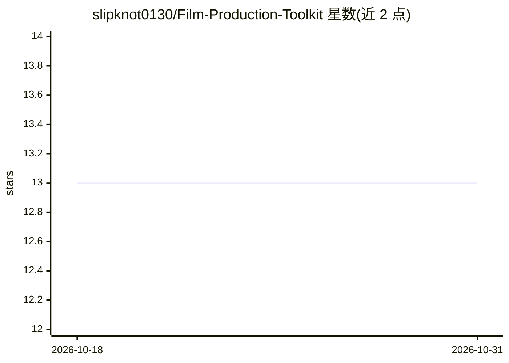

# slipknot0130/Film-Production-Toolkit

⭐ 13 · Python · 推送 2026-09-17 · [GitHub](https://github.com/slipknot0130/Film-Production-Toolkit) · 个人维护 · 中文 README

**面向影视创作者的多智能体剧本创作与制片管理 AI 工作台**

基于 Streamlit 的影视工业文本管线，内置三组协作 Agent（架构师/编剧/剧本医生）模拟编剧室流程，支持 5 种剧本格式、集数级记忆快照与长剧结构化记忆；另提供格式感知剧本分析、预算审计、场景拆解和 AI 视频分镜提示词引擎（Seedance 2.0 兼容，含 20 种情境映射、80/15/5 权重与 6+1 必填字段）。通过 OpenAI SDK 接入 12+ 国内外 LLM 服务商及 Ollama 本地模型。提供一键部署脚本与手动安装两种方式，CrewAI 为可选依赖（未安装时切换轻量分镜引擎）。

## 筛选速览

| 维度 | 判定 | 备注 |
|---|---|---|
| AI 角色 | `ai-native` | 本体是模型或模型工具 |
| 许可风险 | `none` | — |
| 部署形态 | `library` | 以包/库形式分发 |
| 模型依赖 | local-ok | 支持本地模型 |
| 硬件要求 | — | 无带数字的原话,不猜 |
| 安装摩擦 | `low` | 无编译、无系统依赖或容器化 |
| 成熟度 | — | 结构信号不足 |

## 能力要点

- 3-Agent 剧本创作流水线（架构师→编剧→医生）+ 两阶段审批与 HITL 定向修改
- 格式感知双轨审核（情绪/结构/好莱坞工业三种模式）
- AI 视频分镜提示词引擎：20 种情境映射、80/15/5 权重、5 维度视觉连贯性与反渣词库
- Harness 工程化层：断点续传、结构化记忆、JIT 上下文检索与 6 层终止守卫

## 适用场景

- 从灵感到分集剧本的连续长剧创作，且需保持人物与伏线一致
- 把剧本拆解为可直接粘贴到 AI 视频工具（即梦/Kling）的分镜提示词
- 对已有剧本做预算审计、场景拆解与顺场表导出
- 在本地 Ollama 或多个云端服务商之间切换以控制成本

## 场景标签

`多智能体` `AI 写作` · 领域:Agent 开发

## 证据(README 行号)

> L9: 影视创作制片综合工具是一个基于多智能体协作的影视工业文本管线，将**剧本创作**与**制片管理**合为一体。系统内置三组专业AI Agent（架构师、编剧、剧本医生）模拟真实编剧室工作流，通过集数级记忆快照与摘要传递机制解决长剧本上
> L119: ### 🎥 AI 视频分镜提示词引擎（Seedance 2.0 兼容 · 工业级多 Agent 生成）
> L121: 这不是普通的分镜拆解——我们在底层构建了完整的 **AI 视频生成镜头逻辑体系**，让 LLM 输出的分镜可以直接送入即梦、Kling 等 AI 视频工具，无需人工二次加工。

## 星数曲线

2026-10-18 13 → 2026-10-31 13（+0）

---
*卡片 v1 · prompt 1.4 · 生成 2026-10-31 · 置信度 mid · 依据 README sha `15c4e9fa523e` · [字段定义](../../DATASET.md)*
