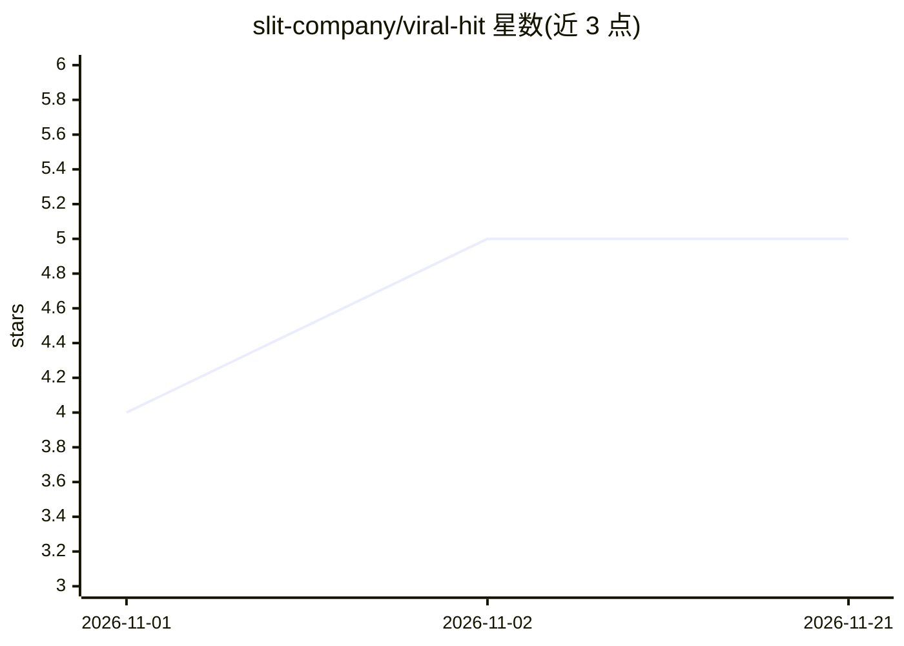

# slit-company/viral-hit

⭐ 5 · TypeScript · Apache-2.0 · 推送 2026-11-03 · [GitHub](https://github.com/slit-company/viral-hit) · 组织维护

**开源创意工作室：用任意模型生成图像视频并完成多轨剪辑发布**

围绕病毒式视频制作流程组织的开源应用：导入参考视频、生成故事板分镜、逐镜头生成、多轨时间线剪辑、发布到 YouTube/Instagram 并记录数据。生成通过 Comfy Router、Higgsfield、fal、Runway、Gemini、OpenAI、xAI、ElevenLabs、Sume 或自有 ComfyUI 服务器等服务的官方 API 完成，密钥在本机加密保存；本地导入、剪辑与 MP4 导出无需任何密钥。所有操作同时是 MCP 工具与 CLI 命令，付费任务有崩溃恢复机制，不需要 GPU 或模型权重。

## 筛选速览

| 维度 | 判定 | 备注 |
|---|---|---|
| AI 角色 | `ai-native` | 本体是模型或模型工具 |
| 许可风险 | `permissive` | Apache-2.0 |
| 部署形态 | `None` |  |
| 模型依赖 | locked-api |  |
| 硬件要求 | — | 无带数字的原话,不猜 |
| 安装摩擦 | `medium` | 含编译或系统依赖之一 |
| 成熟度 | — | 结构信号不足 |

## 能力要点

- 九类创作工具：图像、视频、remix、对口型、配音、音乐、字幕、增强与分析
- 多轨时间线剪辑与 MP4 导出，支持英文/韩文/中文/日文界面
- MCP 与 CLI 让 AI agent 可端到端运行整个流程
- 可插拔的 providers/recipes/skills/发布连接器文件夹架构

## 适用场景

- 研究爆款视频后逐镜头重制并发布
- 在同一个应用里完成生成、剪辑、配音与字幕
- 让 AI agent 通过 MCP 自动执行创作流程

## 场景标签

`图像生成` `视频生成` · 领域:内容生成

## 证据(README 行号)

> L20: Higgsfield promised to open-source its platform. **Viral Hit is our open answer, built around how a viral video act
> L63:  Studio. Nine creation tools: image, video, remix (motion transfer, subject swap, restyle), lip sync, voice, music,
> L131: - **Light by default.** No model weights or GPU are needed to run the studio; heavy engines are optional, separate

## 星数曲线

2026-11-01 4 → 2026-11-21 5（+1）

---
*卡片 v1 · prompt 1.4 · 生成 2026-11-21 · 置信度 high · 依据 README sha `f0982ad724fa` · [字段定义](../../DATASET.md)*
