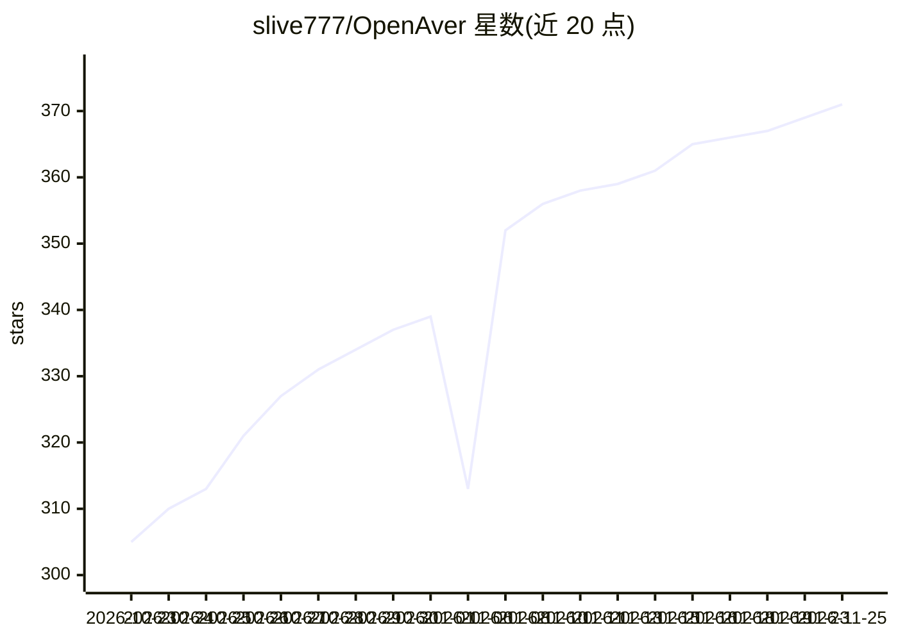

# slive777/OpenAver

⭐ 371 · Python · MIT · 推送 2026-11-23 · [GitHub](https://github.com/slive777/OpenAver) · 个人维护 · 中文 README

**本地 JAV 元数据刮削与媒体库管理桌面应用，产出 NFO 供媒体服务器使用**

桌面应用（FastAPI + PyWebView）：扫描本地影片文件夹生成封面墙，从 8 个网站刮削元数据，写入 Jellyfin/Emby/Kodi 可识别的 NFO 与封面；支持读取 JavSP、MDCX 等工具已整理的收藏，女优/标签别名合并，NAS 唯读来源与 .strm 输出，提供 REST API 与离线网页导出。提供一行安装脚本、Windows/macOS 安装包，免 Docker；macOS 限 Apple 晶片。含 AI 翻译片名（Ollama/Gemini/Claude/OpenAI 端点）与让 Claude Code/Cursor 等工具经 REST API 操作片库的 agent 用法。

## 筛选速览

| 维度 | 判定 | 备注 |
|---|---|---|
| AI 角色 | `ai-enhanced` | 去掉 AI 部分产品仍成立 |
| 许可风险 | `permissive` | MIT |
| 部署形态 | `None` |  |
| 模型依赖 | local-ok | 支持本地模型 |
| 硬件要求 | — | 无带数字的原话,不猜 |
| 安装摩擦 | `low` | 无编译、无系统依赖或容器化 |
| 成熟度 | — | 结构信号不足 |

## 能力要点

- 8 个内置刮削来源，可接 Metatube 扩展 30+ 来源
- 输出 Jellyfin/Emby/Kodi 标准 NFO 与封面，数据留在本地文件夹
- AI 翻译片名：Ollama（本地）/Gemini/Claude/OpenAI 相容端点
- REST API 与 /api/capabilities 端点供 function-calling AI 工具操作

## 适用场景

- 为 Jellyfin/Emby/Kodi 整理本地影片的元数据与封面
- 接手 JavSP/MDCX 等工具已整理的既有收藏继续管理
- NAS 上影片不搬动、以唯读模式生成 .strm 供播放软件使用
- 通过 Claude Code/Cursor 等工具批量整理片库

## 场景标签

 · 领域:媒体管理工具

## 证据(README 行号)

> L15: 把放片的資料夾指給 OpenAver，它會做成一面封面牆：點封面看劇照和標籤，點女優看她的所有片，點標籤找同類；資料不全按一下就從網路補上。
> L42: |**抓資料的來源**|一次查 8 家：JavBus、Jav321、JavDB、DMM、D2Pass、HEYZO、FC2、AVSOX；另 2 家要手動過驗證；可接 Metatube（30+），或請 AI 加自訂來源|
> L44: |**AI 操作**|Claude Code/Cursor 等 AI 工具可以直接下指令整理片庫|

## 星数曲线

2026-10-23 305 → 2026-11-25 371（+66）

---
*卡片 v1 · prompt 1.4 · 生成 2026-11-25 · 置信度 high · 依据 README sha `32296ea06197` · [字段定义](../../DATASET.md)*
