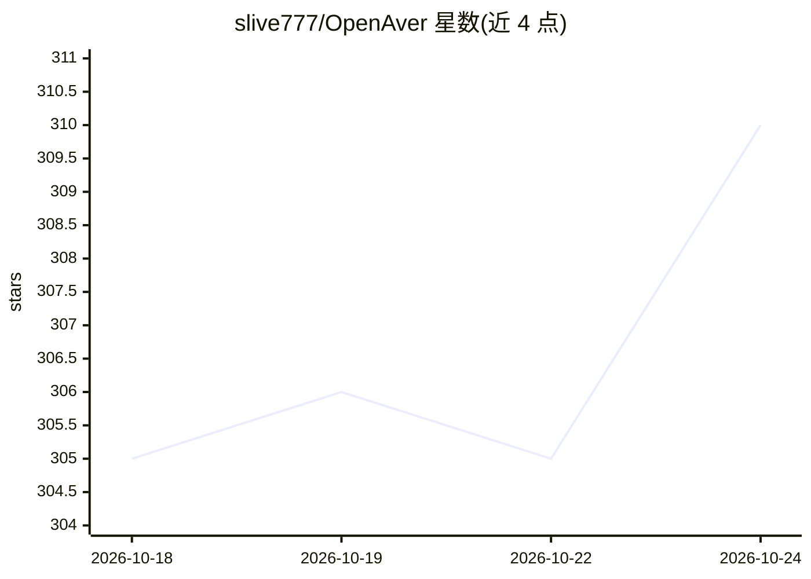

# slive777/OpenAver

⭐ 313 · Python · MIT · 推送 2026-10-24 · [GitHub](https://github.com/slive777/OpenAver) · 个人维护 · 中文 README

**给影视收藏者的本地刮削与封面墙浏览桌面应用**

面向个人影片收藏管理的桌面应用（Windows/macOS Apple 晶片）：扫描本地文件夹，读取已有 NFO 与封面（兼容 JavSP/MDCX/EverAver 等工具的产物），从 8 个内建来源（可接 Metatube 扩至 30+）补齐元数据，生成 Jellyfin/Emby/Kodi 所需的 NFO 与封面，提供封面墙浏览、女优合集、片库图表分析、同 Wi-Fi 手机访问与 REST API。默认不改动不删除原档。其中 AI 为附加功能：日文片名翻译（Ollama/Gemini/Claude/OpenAI 相容端点）与供 function-calling AI 工具调用的本地 capabilities manifest。一行指令安装，免 Docker。

## 筛选速览

| 维度 | 判定 | 备注 |
|---|---|---|
| AI 角色 | `ai-enhanced` | 去掉 AI 部分产品仍成立 |
| 许可风险 | `permissive` | MIT |
| 部署形态 | `None` |  |
| 模型依赖 | local-ok | 支持本地模型 |
| 硬件要求 | — | 无带数字的原话,不猜 |
| 安装摩擦 | `low` | 无编译、无系统依赖或容器化 |
| 成熟度 | — | 结构信号不足 |

## 能力要点

- 8 家内建刮削来源，可接 Metatube 联邦扩至 30+ provider
- 直接读取既有 NFO+封面（JavSP/MDCX/EverAver/Jellyfin/Emby 产物），扫描不改档
- 产出 Jellyfin/Emby/Kodi 的 NFO 与封面，唯读来源可生成 .strm
- 本机 REST API 提供 capabilities manifest，供 Claude Code/Cursor 等 AI 工具调用

## 适用场景

- 把本地影片夹整理成带元数据和封面的收藏，接入 Jellyfin/Emby/Kodi
- 用封面墙按女优、标签、片商浏览和筛选片库
- 让 AI 工具通过本地 API 批量整理片库、收藏女优、加标签

## 场景标签

 · 领域:媒体库管理/桌面工具

## 证据(README 行号)

> L15: 把放片的資料夾指給 OpenAver，它會做成一面封面牆：點封面看劇照和標籤，點女優看她的所有片，點標籤找同類；資料不全按一下就從網路補上。
> L17: **別的工具整理過的收藏，OpenAver 直接讀、不用重新抓資料。** 影片旁只要有資料檔（NFO，記著片名、女優、標籤）和封面圖，掃描就直接讀進來、檔案原封不動——不論是 JavSP、MDCX、EverAver，還是任何寫標準
> L40: |**AI 翻譯**|Ollama（本地免費）/Gemini/Claude/OpenAI 相容端點|

## 星数曲线

2026-10-18 305 → 2026-10-24 310（+5）

---
*卡片 v1 · prompt 1.4 · 生成 2026-10-22 · 置信度 high · 依据 README sha `3d5874594f67` · [字段定义](../../DATASET.md)*
