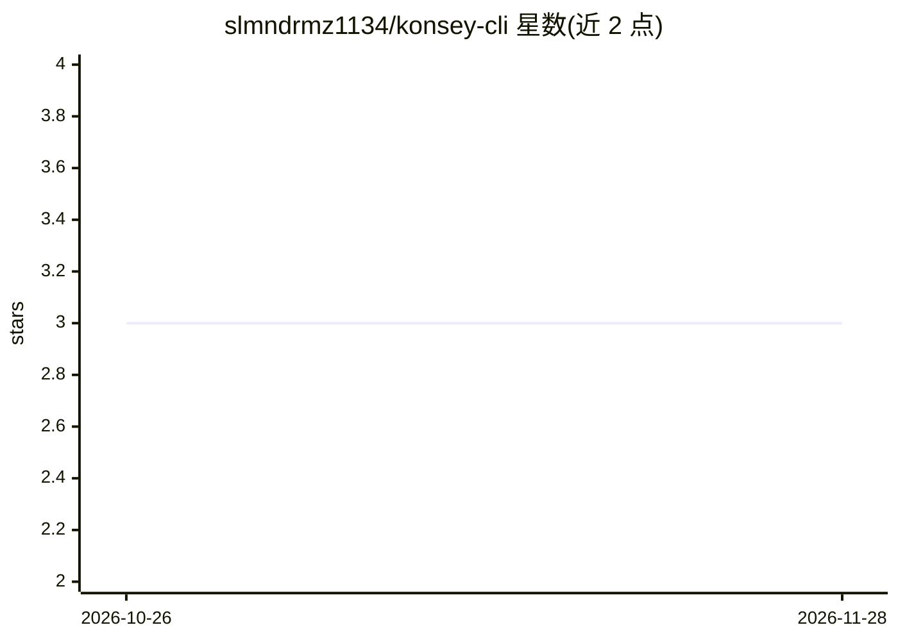

# slmndrmz1134/konsey-cli

⭐ 3 · Python · MIT · 推送 2026-10-20 · [GitHub](https://github.com/slmndrmz1134/konsey-cli) · 个人维护

**跨多个编码 Agent CLI 跑多模型 LLM 评审会的命令行工具**

以 stdlib 单文件 Python 实现，把用户已有的付费 Agent CLI（Codex、Antigravity、OpenCode、Claude Code）作为席位运行三阶段评审：各成员并行独立作答，匿名互评排名，再由主持模型综合出最终答案。无需 OpenRouter 或按 token 计费的 API，直接复用现有订阅；含子进程隔离、硬超时、进程树终止、自偏好投票剔除与失败席位回退等机制。全流程输出保存为 final.md、评审文件与 run.json，另提供 Claude Code skill 包装。

## 筛选速览

| 维度 | 判定 | 备注 |
|---|---|---|
| AI 角色 | `ai-ecosystem` | LLM/agent 周边工具 |
| 许可风险 | `permissive` | MIT |
| 部署形态 | `None` |  |
| 模型依赖 | locked-api |  |
| 硬件要求 | — | 无带数字的原话,不猜 |
| 安装摩擦 | `low` | 无编译、无系统依赖或容器化 |
| 成熟度 | — | 结构信号不足 |

## 能力要点

- 三阶段评审：并行作答、匿名互评排名、主持模型综合
- 复用已有 CLI 订阅，无需 API key 或按 token 计费
- 匿名评审与自偏好投票剔除机制
- Claude Code skill 集成与 Windows/macOS/Linux 运行支持

## 适用场景

- 就架构选型、设计权衡等判断型问题获取多模型共识
- 让不同厂商的模型互相评审以暴露单一模型的盲点
- 在 Claude Code 内通过自然语言发起并汇报评审会

## 场景标签

`多智能体` `模型评测` · 领域:Agent 开发

## 证据(README 行号)

> L25: **Run a karpathy/llm-council-style council across the coding-agent CLIs you already pay for:** Codex, Antigravity (
> L30: stage 1  members answer independently, in parallel (each with its own persona or lens)
> L137: **`workspace`** copies a folder (code, results, a paper) into each member's scratch directory so members can open 

## 星数曲线

2026-10-26 3 → 2026-11-28 3（+0）

---
*卡片 v1 · prompt 1.4 · 生成 2026-11-22 · 置信度 high · 依据 README sha `bc9a4e3e8802` · [字段定义](../../DATASET.md)*
