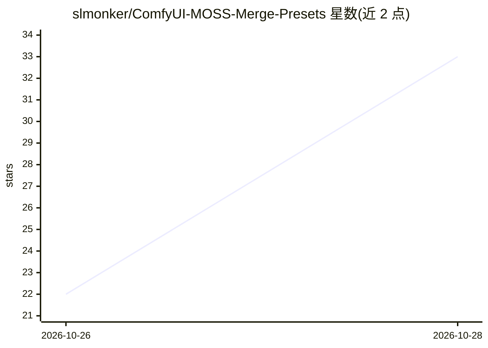

# slmonker/ComfyUI-MOSS-Merge-Presets

⭐ 38 · Python · MIT · 推送 2026-10-26 · [GitHub](https://github.com/slmonker/ComfyUI-MOSS-Merge-Presets) · 个人维护 · 中文 README

**ComfyUI 节点：可复现预设或逐层合并 MOSS-Image Base 与 SFT**

面向 ComfyUI 用户的自定义节点，用于合并 MOSS-Image Base 与 SFT 两套扩散模型权重：提供 Base-preserve / Balanced / SFT-detail 三个一键预设，Custom 模式开放全部 51 个合并分量，并可对 42 个 DiT block 逐层调节权重。支持 int8c / convrot 量化模型的合并（保持 Base 的量化布局），输出可通过 ComfyUI 内置 ModelSave 保存。限制：线性合并不等价于正交层控制，构图对 seed 敏感，且不含模型权重。安装方式为克隆到 custom_nodes 目录。

## 筛选速览

| 维度 | 判定 | 备注 |
|---|---|---|
| AI 角色 | `ai-ecosystem` | LLM/agent 周边工具 |
| 许可风险 | `permissive` | MIT |
| 部署形态 | `None` |  |
| 模型依赖 | — | README 未给出锁定关系 |
| 硬件要求 | — | 无带数字的原话,不猜 |
| 安装摩擦 | `low` | 无编译、无系统依赖或容器化 |
| 成熟度 | — | 结构信号不足 |

## 能力要点

- 三个一键预设 + Custom 模式开放 51 个合并分量
- 对全部 42 个 MOSS-Image DiT block 逐层控制权重
- 支持 int8c / convrot 量化 Base+SFT 合并，保持量化布局不回退 BF16
- 除 ComfyUI 本身外无额外 Python 依赖

## 适用场景

- 保留 Base 构图同时继承 SFT 的排版与细节能力
- 逐层实验不同合并权重并保存合并后的模型
- 在 ComfyUI 原生 MOSS-Image 流水线中直接采样合并模型

## 场景标签

`图像生成` · 领域:内容生成

## 证据(README 行号)

> L8: A ComfyUI custom node for merging **MOSS-Image Base** and **SFT** with reproducible presets or full per-layer contro
> L34: - Per-layer control over all 42 MOSS-Image DiT blocks.

## 星数曲线

2026-10-26 22 → 2026-10-28 33（+11）

---
*卡片 v1 · prompt 1.4 · 生成 2026-10-27 · 置信度 high · 依据 README sha `8dec5c8805de` · [字段定义](../../DATASET.md)*
