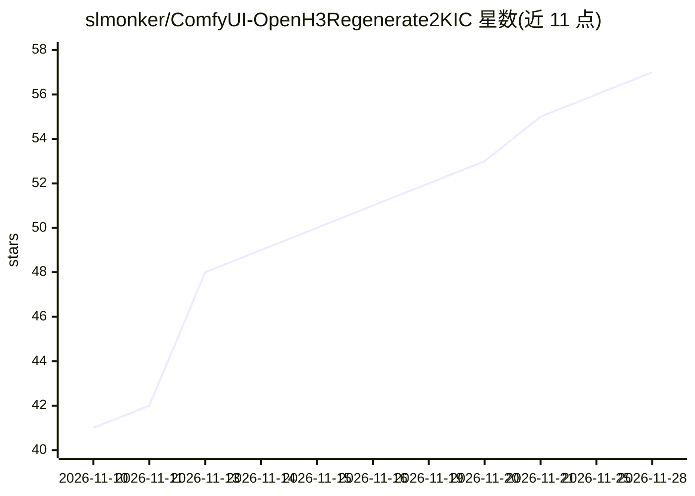

# slmonker/ComfyUI-OpenH3Regenerate2KIC

⭐ 57 · Python · Apache-2.0 · 推送 2026-11-09 · [GitHub](https://github.com/slmonker/ComfyUI-OpenH3Regenerate2KIC) · [官网](https://huggingface.co/slmonker/Open-H3-Regenerate-2K-IC-ComfyUI) · 个人维护 · 中文 README

**在 ComfyUI 中运行 Open-H3-Regenerate-2K 视频精修的节点与工作流**

为 NVlabs/Sana 的 Open-H3-Regenerate-2K/IC 提供的 ComfyUI 节点集、示例工作流及转换后的 LoRA 权重（发布于 Hugging Face）。支持三种流程：文生视频（文本生成 768P 草稿后精修至 2560×1440）、参考图生视频、以及已有 768P 草稿精修到 2K。包含草稿预处理（124 帧/24fps、裁剪至 1344×768）、官方提示词拼接、sigma 网格与目标 latent 组合等节点，并附 LoRA 转换脚本（Diffusers→ComfyUI）。面向使用 ComfyUI 的 AI 视频生成用户；注意 2K 精修在 32GB 显存上需模型卸载，4K 通常不可行，非 MiniMax 官方产品。

## 筛选速览

| 维度 | 判定 | 备注 |
|---|---|---|
| AI 角色 | `ai-ecosystem` | LLM/agent 周边工具 |
| 许可风险 | `permissive` | Apache-2.0 |
| 部署形态 | `None` |  |
| 模型依赖 | — | README 未给出锁定关系 |
| 硬件要求 | `gpu-24g` | |
| 安装摩擦 | `low` | 无编译、无系统依赖或容器化 |
| 成熟度 | — | 结构信号不足 |

## 能力要点

- 三种工作流：文生视频 / 参考图生视频 / 768P 草稿精修至 2560×1440
- 提供 Diffusers→ComfyUI LoRA 转换脚本（312 层、624 张量、BF16 输出）
- 草稿预处理节点：124 帧 24fps 采样、cover 裁剪、音频按真实采样率裁剪/填充
- 附带单元测试与工作流加载校验（graphToPrompt 零输入 schema 错误）

## 适用场景

- 在 ComfyUI 中把 768P 视频草稿精修到 2K（2560×1440）
- 从文本提示词直接生成 2K 视频（先草稿后 IC 精修）
- 转换并使用官方 IC LoRA 的 ComfyUI 版本

## 场景标签

`视频生成` `图像视频处理` · 领域:内容生成

## 证据(README 行号)

> L5: ComfyUI nodes and example workflows for
> L10: 1. **Text-to-video example** — text → 768P H3 draft → IC 2K refinement.

## 星数曲线

2026-11-10 41 → 2026-11-28 57（+16）

---
*卡片 v1 · prompt 1.4 · 生成 2026-11-18 · 置信度 high · 依据 README sha `6e65d3bdfc26` · [字段定义](../../DATASET.md)*
