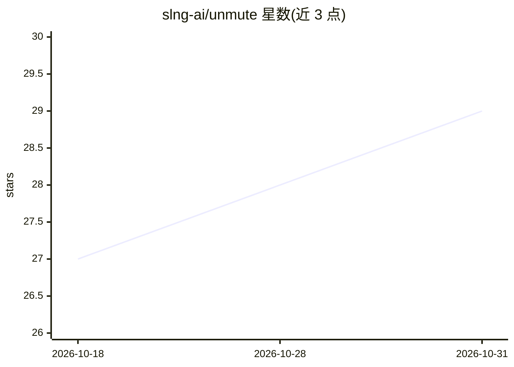

# slng-ai/unmute

⭐ 29 · Go · MIT · 推送 2026-10-20 · [GitHub](https://github.com/slng-ai/unmute) · [官网](https://unmute.ai) · 组织维护

**语音 agent 编译器：用 YAML 声明，编译为 Pipecat/LiveKit 等运行时代码**

命令行编译器：开发者以 agent.yaml、instructions.md、tools/ 与 state.py 组成的包描述语音 agent 的模型、工具、状态与流程，unmute 编译为可自托管的 Python 项目，支持 LiveKit Agents、Pipecat 两个代码目标，以及 SLNG 托管与 Twilio 电话接入共四个目标。编译产物使用固定版本依赖、含 Dockerfile，运行时不依赖 Unmute。unmute validate 离线校验包并指出错误所在文件与行；类型化状态用 Pydantic 定义，值在写入时校验。SLNG/Twilio 目标不支持部分需要 unmute-core 的特性（如 save/precheck/confirm）。

## 筛选速览

| 维度 | 判定 | 备注 |
|---|---|---|
| AI 角色 | `ai-ecosystem` | LLM/agent 周边工具 |
| 许可风险 | `permissive` | MIT |
| 部署形态 | `desktop` | 安装包/桌面程序 |
| 模型依赖 | — | README 未给出锁定关系 |
| 硬件要求 | — | 无带数字的原话,不猜 |
| 安装摩擦 | `low` | 无编译、无系统依赖或容器化 |
| 成熟度 | — | 结构信号不足 |

## 能力要点

- YAML+Markdown 包编译为 Pipecat/LiveKit 的 Python 项目，运行时不依赖 Unmute
- 四个目标：LiveKit Agents、Pipecat、SLNG 托管、Twilio ConversationRelay
- unmute validate 离线校验：命名文件与行的错误报告加警告
- Pydantic 类型化状态：电话号码/日期/邮箱等在值写入时校验
- 13 个 SLNG 语音网关区域与独立的 worker 部署区域选择

## 适用场景

- 用声明式 YAML 定义语音 agent 并生成可自托管的 Python 代码
- 将同一 agent 包编译到多个运行时（LiveKit/Pipecat/SLNG/Twilio）
- 在上线前静态校验 agent 包中的状态引用与流程错误

## 场景标签

`语音 Agent` `Agent 框架` · 领域:Agent 开发

## 证据(README 行号)

> L11: Unmute is a command line compiler for voice agents. You write a small package of
> L14: steps. Unmute turns that into a real Python project for the orchestrator you
> L101: |LiveKit Agents|code|`build/livekit/agent.py`, a Python project you host and run|

## 星数曲线

2026-10-18 27 → 2026-10-31 29（+2）

---
*卡片 v1 · prompt 1.4 · 生成 2026-10-26 · 置信度 mid · 依据 README sha `3ee15ccd4fe7` · [字段定义](../../DATASET.md)*
