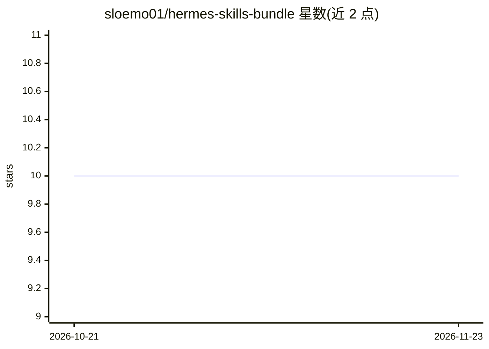

# sloemo01/hermes-skills-bundle

⭐ 10 · PowerShell · MIT · 推送 2026-07-28 · [GitHub](https://github.com/sloemo01/hermes-skills-bundle) · 个人维护

**为 Hermes Agent 提供的 9 个浏览器自动化技能包**

面向 Hermes Agent 桌面应用的技能集合，包含 9 个跨平台技能：通过 Kimi WebBridge 守护进程与 Chrome 扩展让 Hermes 控制用户本机 Chrome 浏览器并复用真实登录会话。技能覆盖深度网页研究、LinkedIn/招聘自动化、跨平台人物核查、MCP 服务器检索、提示词分析与引导式记忆配置。提供 Windows PowerShell 与 macOS/Linux 一键安装脚本，安装后需配置 NVIDIA NIM API key 并安装 Chrome 扩展。部分银行/验证码站点会阻止合成点击。

## 筛选速览

| 维度 | 判定 | 备注 |
|---|---|---|
| AI 角色 | `ai-ecosystem` | LLM/agent 周边工具 |
| 许可风险 | `permissive` | MIT |
| 部署形态 | `None` |  |
| 模型依赖 | — | README 未给出锁定关系 |
| 硬件要求 | — | 无带数字的原话,不猜 |
| 安装摩擦 | `low` | 无编译、无系统依赖或容器化 |
| 成熟度 | — | 结构信号不足 |

## 能力要点

- 9 个技能：深度研究、招聘/LinkedIn 自动化、OSINT 人物核查、MCP 服务器检索等
- 通过 Kimi WebBridge 控制本机 Chrome 并复用真实登录会话
- 支持 Windows/macOS/Linux，一键安装脚本自动下载守护进程并克隆技能
- 10+ 标签页并行的深度网页研究工作流

## 适用场景

- 让 Hermes 自主执行多标签页的深度网页调研并生成报告
- 在 LinkedIn/Indeed 等平台自动检索并提取职位信息
- 跨 12+ 社交/公开平台核查某人的身份与资料

## 场景标签

`浏览器自动化` · 领域:效率与自动化

## 证据(README 行号)

> L10: By combining the **Hermes Agent**, **NVIDIA Nemotron 3 Ultra**, and **Kimi WebBridge**, these 9 cross-platform skil
> L38: ## 🤖 What's Included? (9 Skills)
> L94: * **Hermes Agent** — Nous Research (desktop app, skill system)

## 星数曲线

2026-10-21 10 → 2026-11-23 10（+0）

---
*卡片 v1 · prompt 1.4 · 生成 2026-11-19 · 置信度 high · 依据 README sha `2eeb418c53a4` · [字段定义](../../DATASET.md)*
