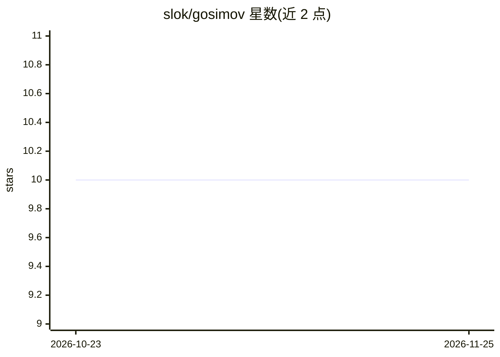

# slok/gosimov

⭐ 10 · Go · 推送 2026-09-01 · [GitHub](https://github.com/slok/gosimov) · 个人维护

**面向 Go 开发者的嵌入式 LLM agent 构建库**

gosimov 是一个 Go SDK，用于构建带工具调用的有状态 LLM agent。核心机制包括：内置工具调用循环（JSON schema 契约与结构化工具结果）、会话 API（Prompt/Continue/Compact）、多 provider 接入与自定义 OpenAI 兼容 provider、持久化后端（memory/jsonl）、上下文压缩与运行时状态跟踪。设计面向基础设施/SRE 自动化场景，通过仅暴露显式工具、命名空间/集群策略校验、审批与审计日志等方式构建护栏。经 go get 安装。

## 筛选速览

| 维度 | 判定 | 备注 |
|---|---|---|
| AI 角色 | `ai-ecosystem` | LLM/agent 周边工具 |
| 许可风险 | `none` | — |
| 部署形态 | `None` |  |
| 模型依赖 | local-ok | 支持本地模型 |
| 硬件要求 | — | 无带数字的原话,不猜 |
| 安装摩擦 | `low` | 无编译、无系统依赖或容器化 |
| 成熟度 | — | 结构信号不足 |

## 能力要点

- 内置工具调用循环，JSON schema 契约与自动执行 agent loop
- 多 provider 支持，并可自定义 OpenAI 兼容 provider 接入本地服务
- memory/jsonl 持久化、上下文压缩与运行时状态/用量跟踪
- 护栏设计：显式工具白名单、域策略校验、审批/审计/RBAC 在代码路径内

## 适用场景

- 在 Kubernetes controller/operator 中嵌入基础设施自动化 agent
- 构建带文件与 shell 工具的编码助手/会话查看器
- SRE 运维自动化助手编排受限的基础设施工作流

## 场景标签

`Agent 框架` · 领域:Agent 开发

## 证据(README 行号)

> L5: `gosimov` is a simple Go SDK for building stateful LLM agents with tools.
> L7: It is designed for real automation workflows, especially in infra/SRE environments where Go is a common language for
> L15: - Multi-provider support (Zen, OpenCode Go, OpenAI, ChatGPT/Codex).

## 星数曲线

2026-10-23 10 → 2026-11-25 10（+0）

---
*卡片 v1 · prompt 1.4 · 生成 2026-11-19 · 置信度 high · 依据 README sha `f9b41da6f638` · [字段定义](../../DATASET.md)*
