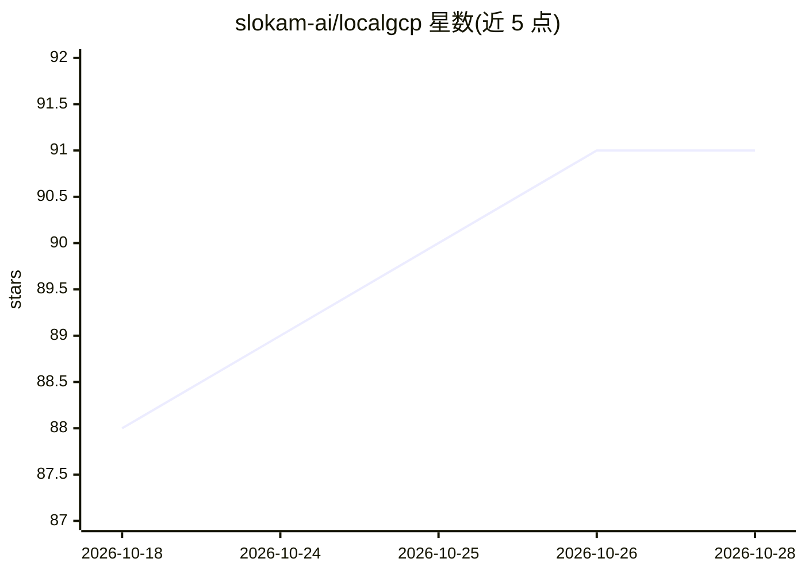

# slokam-ai/localgcp

⭐ 91 · Go · MIT · 推送 2026-04-16 · [GitHub](https://github.com/slokam-ai/localgcp) · [官网](https://localgcp.com) · 组织维护

**本地模拟 14 个 GCP 服务的 Go 单二进制模拟器**

用单个 Go 二进制在 localhost 模拟 14 个 Google Cloud 服务（Vertex AI、BigQuery、Spanner、Firestore、Pub/Sub、Cloud Storage、Bigtable、Cloud SQL、Memorystore、Cloud Tasks、KMS、Secret Manager、Cloud Run、Cloud Logging），供 GCP 应用开发与测试使用，零云账单、零 API key。现有 GCP 客户端库通过 *_EMULATOR_HOST 环境变量无改动接入。9 个服务以 Go 原生实现，5 个（Spanner、Bigtable、Cloud SQL、Memorystore、BigQuery）通过 Docker 容器惰性编排。Vertex AI 部分可将 google.golang.org/genai SDK 指向本地模型（默认 Ollama 后端，也支持 OpenAI/Anthropic/stub），无 Ollama 时返回确定性桩响应。部分服务特性尚未实现（如对象组合、消息排序、多模态），且不做 IAM/鉴权校验。

## 筛选速览

| 维度 | 判定 | 备注 |
|---|---|---|
| AI 角色 | `ai-ecosystem` | LLM/agent 周边工具 |
| 许可风险 | `permissive` | MIT |
| 部署形态 | `self-host` | docker 或自建部署 |
| 模型依赖 | local-ok | 支持本地模型 |
| 硬件要求 | — | 无带数字的原话,不猜 |
| 安装摩擦 | `low` | 无编译、无系统依赖或容器化 |
| 成熟度 | — | 结构信号不足 |

## 能力要点

- 单个 Go 二进制模拟 14 个 GCP 服务，9 个原生实现、5 个经 Docker 惰性编排
- GCP 官方客户端库通过 *_EMULATOR_HOST 零改动接入
- Vertex AI 接口可路由到 Ollama/OpenAI/Anthropic 后端，支持模型别名映射，或返回确定性桩响应用于 CI
- 默认内存存储，支持 --data-dir 持久化

## 适用场景

- 本地开发调试 GCP 应用，避免云账单与网络延迟
- CI/CD 集成测试，无需云凭证即可测试真实 GCP 客户端库
- 离线环境下运行依赖 GCP 服务的应用
- 将 Vertex AI 代码指向本地 Ollama 模型做推理测试

## 场景标签

 · 领域:云服务模拟/开发工具

## 证据(README 行号)

> L7: **Now with Vertex AI.** Run your `google.golang.org/genai` code against local LLMs via Ollama. Zero code changes, re
> L162: - Multi-provider backends: Ollama (default), OpenAI, Anthropic, or stub
> L164: - Works with the official `google.golang.org/genai` SDK via `HTTPOptions.BaseURL`

## 星数曲线

2026-10-18 88 → 2026-10-28 91（+3）

---
*卡片 v1 · prompt 1.4 · 生成 2026-10-23 · 置信度 high · 依据 README sha `a5a121efd183` · [字段定义](../../DATASET.md)*
