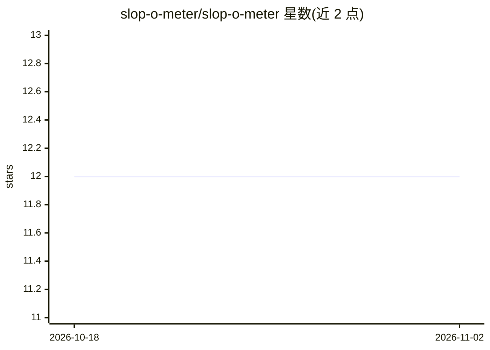

# slop-o-meter/slop-o-meter

⭐ 12 · TypeScript · AGPL-3.0 · 推送 2026-06-14 · [GitHub](https://github.com/slop-o-meter/slop-o-meter) · [官网](https://slop-o-meter.dev) · 个人维护

**实验性工具：用 git 历史度量项目的 LLM 代码 slop 程度**

一个测量“软件 slop”的实验项目：通过项目的 git 历史与 GitHub 活动估计“所需注意力”（代码库历史规模）与“已投入注意力”（提交、PR 评论等人类交互信号），逐周计算 1-5 级 slop 评分（大量代码新增而人类活动少则加分）。作者自述结果不可靠：闭门开发后一次性合入的代码与 vendored 依赖、大配置文件等因素均会干扰估计。社区可通过 PR 获得预览环境测试新算法。README 未给出安装或运行方式。

## 筛选速览

| 维度 | 判定 | 备注 |
|---|---|---|
| AI 角色 | `ai-ecosystem` | LLM/agent 周边工具 |
| 许可风险 | `viral` | AGPL-3.0 |
| 部署形态 | `None` |  |
| 模型依赖 | — | README 未给出锁定关系 |
| 硬件要求 | — | 无带数字的原话,不猜 |
| 安装摩擦 | `low` | 无编译、无系统依赖或容器化 |
| 成熟度 | `idea` | |

## 能力要点

- 基于 git 历史与 GitHub 人类交互信号估计注意力成本与投入
- 逐周计算 1-5 级 slop 评分
- 作者自述结果对许多仓库不准确，两项度量过于间接
- 可通过 PR 获得预览环境试验改进算法

## 适用场景

- 对开源项目跑一个实验性的 slop 评分看看结果
- 探索如何量化 LLM 生成代码的审核程度
- 基于其预览环境尝试改进度量算法

## 场景标签

 · 领域:软件工程/代码质量分析

## 证据(README 行号)

> L26: We use a project's git history and GitHub activity to estimate the two attention
> L28: attention, we look at "signals of human interaction" like commits and PR

## 星数曲线

2026-10-18 12 → 2026-11-02 12（+0）

---
*卡片 v1 · prompt 1.4 · 生成 2026-11-01 · 置信度 mid · 依据 README sha `af781852f3fb` · [字段定义](../../DATASET.md)*
