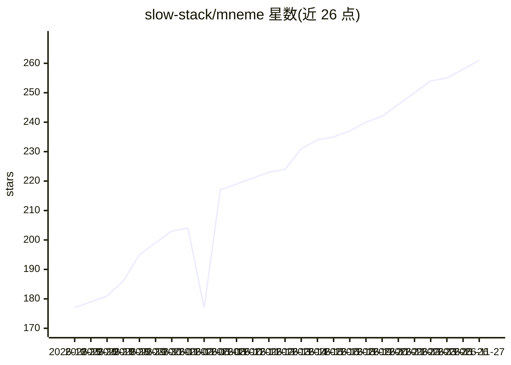

# slow-stack/mneme

⭐ 261 · JavaScript · MIT · 推送 2026-11-26 · [GitHub](https://github.com/slow-stack/mneme) · [官网](https://www.npmjs.com/package/@modusensus/dsh-mneme) · 组织维护 · 中文 README

**给 AI agent 跨会话记忆：本机文件存储，空闲巩固**

DeepSeek Harness 的跨会话长期记忆插件：对话结束时蒸馏事实、偏好与决定写入本机 SQLite 与十份 Markdown 镜像；下次会话四路并行召回、融合排序后注入上下文；空闲时段由 autoDream 合并重复、压缩陈旧、归档过期。冲突记忆冻结并列，由用户裁决；每条记忆带来源与整理回放账目。另提供独立 MCP server、常驻 daemon 与外部 HTTP API。硬性要求 Node 24+ 与 DSH 0.1.x/0.2.x。

## 筛选速览

| 维度 | 判定 | 备注 |
|---|---|---|
| AI 角色 | `ai-ecosystem` | LLM/agent 周边工具 |
| 许可风险 | `permissive` | MIT |
| 部署形态 | `None` |  |
| 模型依赖 | locked-api |  |
| 硬件要求 | — | 无带数字的原话,不猜 |
| 安装摩擦 | `low` | 无编译、无系统依赖或容器化 |
| 成熟度 | — | 结构信号不足 |

## 能力要点

- 写入→巩固→四路召回→注入的记忆闭环，质量闸保证原子记忆
- SQLite 正本 + 十份可手改 Markdown 镜像，手改内容合并时优先保留
- autoDream 空闲巩固：合并、压缩、归档，整理过程可复现回放
- 独立 MCP server（mneme-memory）供 Claude Code/Cursor/Codex 等客户端挂载六个记忆工具

## 适用场景

- 让编码 agent 记住项目背景与既定决定，跨会话继续工作
- 按 agent/工作区隔离记忆并完全离线运行语义检索
- 手工编辑 Markdown 文件接管并审计 AI 的长期记忆

## 场景标签

`Agent 记忆` · 领域:Agent 开发

## 证据(README 行号)

> L25: **dsh-mneme** 给 DeepSeek Harness 一份跨会话的记忆：对话结束，值得留下的部分自动蒸馏进本机；下次开口，相关的几条自己浮上来。记忆不是锁在向量库里的一堆浮点数——它落在本机的一份 SQLite，旁边配
> L87: |**MCP**|一个零依赖 stdio server（独立包 `mneme-memory`）；Claude Code / Cursor / Codex / OpenCode 等任何 MCP 客户端都能挂上六个记忆工具|

## 星数曲线

2026-10-25 177 → 2026-11-27 261（+84）

---
*卡片 v1 · prompt 1.4 · 生成 2026-11-26 · 置信度 high · 依据 README sha `e31105fe8f13` · [字段定义](../../DATASET.md)*
