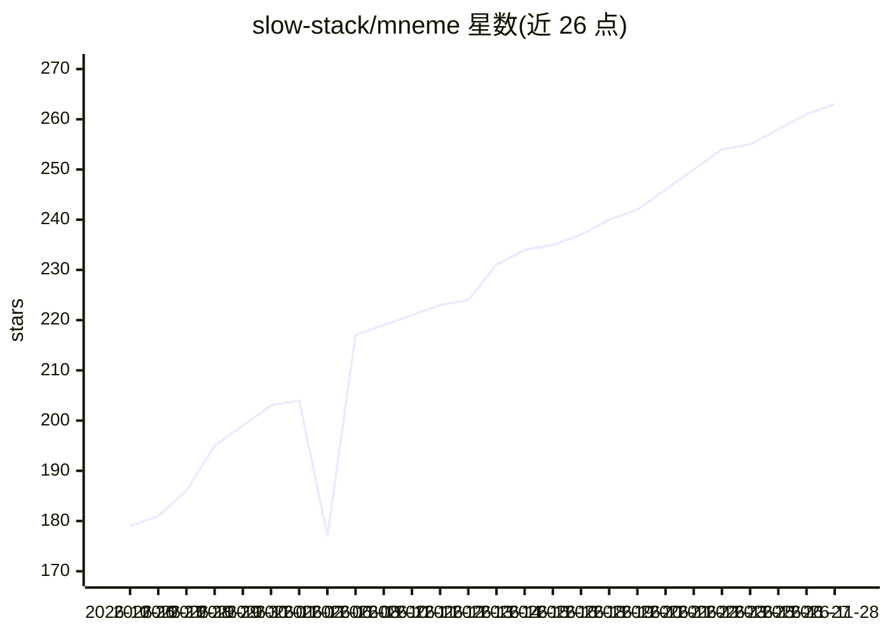

# slow-stack/mneme

⭐ 263 · JavaScript · MIT · 推送 2026-11-26 · [GitHub](https://github.com/slow-stack/mneme) · [官网](https://www.npmjs.com/package/@modusensus/dsh-mneme) · 组织维护 · 中文 README

**给 DeepSeek Harness 上的 AI agent 提供跨会话长期记忆**

以 DeepSeek Harness 插件形式运行的长期记忆系统：对话结束时自动蒸馏事实、偏好与决定，存入本机 SQLite 正本并配十份可手改的 Markdown 镜像；空闲期由 autoDream 合并重复、压缩陈旧；召回时四路并行检索、按热度/近因/重要度排序注入上下文；冲突记忆冻结待用户裁决。另提供零依赖 MCP stdio server、独立 daemon 与 HTTP API 三种接入方式。安装要求 Node 24+ 与 DSH 0.1.x/0.2.x。

## 筛选速览

| 维度 | 判定 | 备注 |
|---|---|---|
| AI 角色 | `ai-ecosystem` | LLM/agent 周边工具 |
| 许可风险 | `permissive` | MIT |
| 部署形态 | `None` |  |
| 模型依赖 | locked-api |  |
| 硬件要求 | — | 无带数字的原话,不猜 |
| 安装摩擦 | `low` | 无编译、无系统依赖或容器化 |
| 成熟度 | — | 结构信号不足 |

## 能力要点

- 本机 SQLite + 十份 Markdown 镜像，无私有格式锁定，无遥测
- autoDream 空闲巩固：合并重复、压缩陈旧、归档过期
- 四路并行召回，按热度/近因/重要度排序注入上下文
- MCP server 可挂 Claude Code / Cursor / Codex / OpenCode 等客户端

## 适用场景

- 让 agent 记住我的项目背景、偏好与既定决定，下次对话不用重讲
- 在本地离线环境保存和检索记忆，不走云服务
- 手工编辑 Markdown 镜像来修正或管理记忆内容

## 场景标签

`Agent 记忆` · 领域:Agent 开发

## 证据(README 行号)

> L25: **dsh-mneme** 给 DeepSeek Harness 一份跨会话的记忆：对话结束，值得留下的部分自动蒸馏进本机；下次开口，相关的几条自己浮上来。记忆不是锁在向量库里的一堆浮点数——它落在本机的一份 SQLite，旁边配
> L87: |**MCP**|一个零依赖 stdio server（独立包 `mneme-memory`）；Claude Code / Cursor / Codex / OpenCode 等任何 MCP 客户端都能挂上六个记忆工具|

## 星数曲线

2026-10-26 179 → 2026-11-28 263（+84）

---
*卡片 v1 · prompt 1.4 · 生成 2026-11-27 · 置信度 high · 依据 README sha `24772bc9d3db` · [字段定义](../../DATASET.md)*
