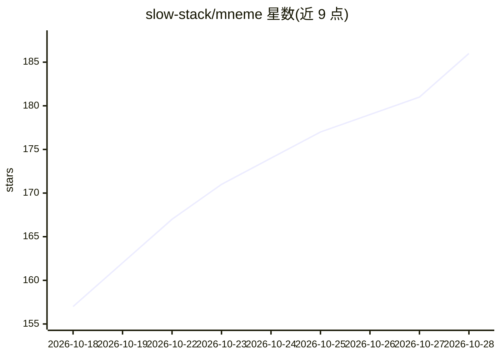

# slow-stack/mneme

⭐ 195 · JavaScript · MIT · 推送 2026-10-28 · [GitHub](https://github.com/slow-stack/mneme) · [官网](https://www.npmjs.com/package/@modusensus/dsh-mneme) · 组织维护 · 中文 README

**给 DeepSeek Harness 装跨会话记忆的插件，本地 SQLite+Markdown**

dsh-mneme 是 DeepSeek Harness (DSH) 的跨会话记忆插件：记忆落在本机 SQLite 并同步为可手工编辑的 Markdown 镜像，后台 autoDream 自动去重合并、矛盾先冻结挂起等人工裁决，检索支持关键词/向量/BM25/实体四路召回，可设 embedProvider=local 完全离线。提供记忆面板、10 个模型工具、零依赖 stdio MCP server（记忆六件套）与 CLI；配套 dsh-mneme-serve 可在不开 DSH 时跑常驻数据面。记忆按 agent 与工作区隔离（可关），每次自动整理留可回放的决策凭证。

## 筛选速览

| 维度 | 判定 | 备注 |
|---|---|---|
| AI 角色 | `ai-ecosystem` | LLM/agent 周边工具 |
| 许可风险 | `permissive` | MIT |
| 部署形态 | `library` | 以包/库形式分发 |
| 模型依赖 | locked-api |  |
| 硬件要求 | — | 无带数字的原话,不猜 |
| 安装摩擦 | `low` | 无编译、无系统依赖或容器化 |
| 成熟度 | `idea` | |

## 能力要点

- SQLite + Markdown 双向同步，人工改动被优先尊重
- autoDream 后台巩固：去重合并、矛盾冻结待人工裁决、留可回放决策凭证
- 四路召回（关键词/向量/BM25/实体），embedProvider=local 可完全离线
- 零依赖 stdio MCP server（mneme-memory），Claude Code/Cursor/Codex 等客户端可挂载

## 适用场景

- 让 DSH 的 AI 记住我聊过的项目、偏好与决定，跨会话生效
- 多 Agent、多项目场景下隔离并管理各自的记忆
- 通过 MCP 让其他 AI 工具（Claude Code/Cursor 等）读写同一份记忆库

## 场景标签

`Agent 记忆` · 领域:Agent 开发

## 证据(README 行号)

> L18: **dsh-mneme** 是 DeepSeek Harness (DSH) 的跨会话记忆插件。它不只「存得下」，更「管得好」：后台自动去重合并、矛盾先冻结等你裁决、全程可回放审计、记忆只落在本机，还支持导出成人可读的 Markd
> L168: 插件自带零依赖 stdio MCP server（独立 npm 包 **`mneme-memory`**，bin 名 `mneme-mcp`），任何 MCP 客户端都能挂载记忆六件套（`memory_save` / `memor
> L193: npm i -g @modusensus/dsh-mneme

## 星数曲线

2026-10-18 157 → 2026-10-28 186（+29）

---
*卡片 v1 · prompt 1.4 · 生成 2026-10-22 · 置信度 high · 依据 README sha `597b3d526de9` · [字段定义](../../DATASET.md)*
