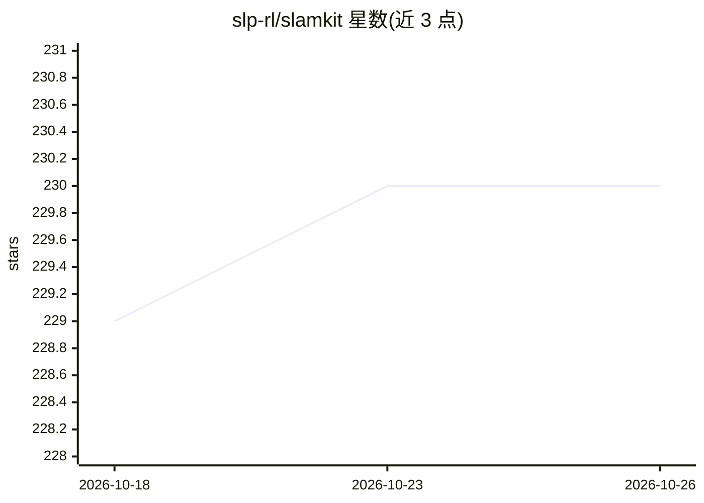

# slp-rl/slamkit

⭐ 230 · Python · MIT · 推送 2026-03-14 · [GitHub](https://github.com/slp-rl/slamkit) · [官网](https://pages.cs.huji.ac.il/adiyoss-lab/slamming/) · 组织维护

**SpeechLM 训练与评测工具包：单 GPU 一天内训练语音语言模型**

用于训练与评测语音语言模型的开源工具包，覆盖语音预训练、偏好对齐（仅 DPO）、语音-文本交错训练等流程。核心机制是把流程拆为特征提取、token 准备、训练、评测四个脚本，通过共享预计算表示节省时间；配置用 Hydra 管理，训练参数直接透传 HuggingFace 模型。评测支持 sWUGGY、sBLIMP、Spoken StoryCloze、SALMon 及生成续写与 GenPPL/Auto-BLEU。也可作为 Python 库加载预训练模型。python>=3.11，pip 源码安装，部分功能需额外装 flash_attention。

## 筛选速览

| 维度 | 判定 | 备注 |
|---|---|---|
| AI 角色 | `ai-ecosystem` | LLM/agent 周边工具 |
| 许可风险 | `permissive` | MIT |
| 部署形态 | `library` | 以包/库形式分发 |
| 模型依赖 | — | README 未给出锁定关系 |
| 硬件要求 | — | 无带数字的原话,不猜 |
| 安装摩擦 | `low` | 无编译、无系统依赖或容器化 |
| 成熟度 | — | 结构信号不足 |

## 能力要点

- 四阶段脚本流程，共享预计算表示以节省训练时间
- 支持语音预训练、DPO 偏好对齐与语音-文本交错训练
- 评测指标含 sWUGGY、sBLIMP、Spoken StoryCloze、SALMon、GenPPL、Auto-BLEU
- 可作为库使用，加载 slprl/slam_scaled 预训练模型

## 适用场景

- 在单 GPU 上训练语音语言模型
- 对已训练 SpeechLM 跑基准评测或生成语音续写
- 构建自定义 SpeechLM 训练流程并复用预计算特征

## 场景标签

`模型训练` `模型评测` · 领域:评测与运维

## 证据(README 行号)

> L2: 🗣️This repository is a growing, fully open-source toolkit for training and evaluating Speech Language Models. This
> L26: Our package is built with four main scripts, corresponding to four main stages: extract_features.py, prepare_tokens

## 星数曲线

2026-10-18 229 → 2026-10-26 230（+1）

---
*卡片 v1 · prompt 1.4 · 生成 2026-10-22 · 置信度 high · 依据 README sha `baf150c83815` · [字段定义](../../DATASET.md)*
