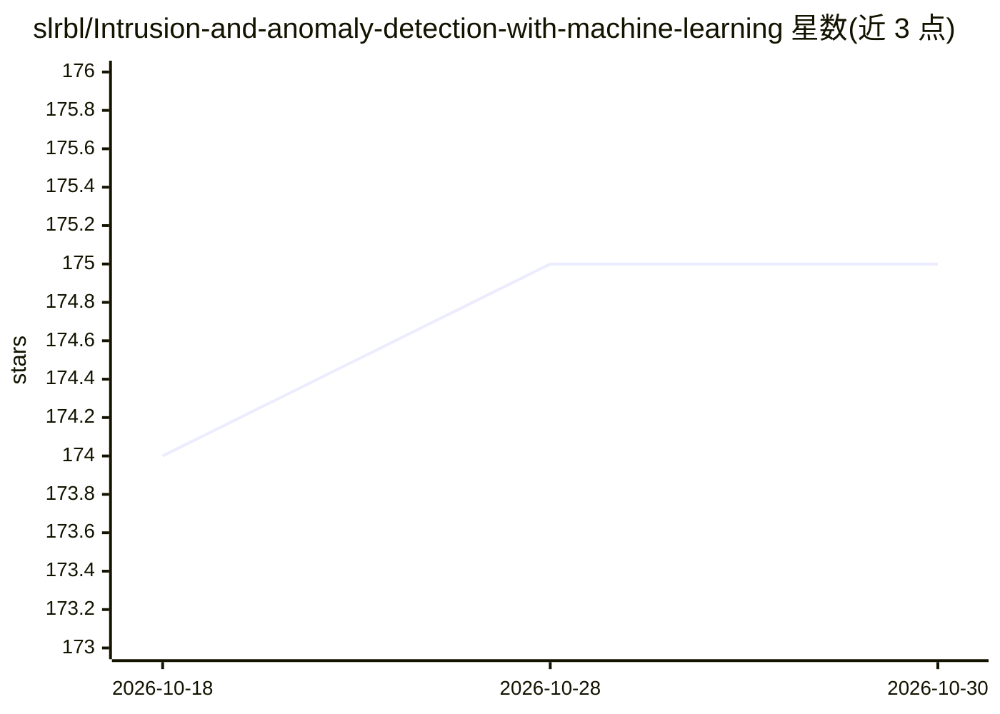

# slrbl/Intrusion-and-anomaly-detection-with-machine-learning

⭐ 175 · Ruby · MIT · 推送 2026-10-29 · [GitHub](https://github.com/slrbl/Intrusion-and-anomaly-detection-with-machine-learning) · 个人维护

**无监督 ML 日志入侵/异常检测工具，附 LLM 分析与 Web UI**

Webhawk/Catch 3.0 面向 SOC 团队与安全分析人员：读取 HTTP 等应用日志（也支持 top 输出的 OS 进程统计），经 PCA 特征提取后用 DBSCAN 聚类找出可能代表攻击痕迹的离群点；检测结果再交由用户选择的 LLM（内置 Ollama 服务）做深入分析与建议，采用 agentic AI 设计模式。提供 Web 界面、API（可对接 SIEM）与端点 agent，Docker Compose 部署检测引擎、Web 应用与 LLM 三个服务。高级用户可调节 DBSCAN 参数。

## 筛选速览

| 维度 | 判定 | 备注 |
|---|---|---|
| AI 角色 | `ai-native` | 本体是模型或模型工具 |
| 许可风险 | `permissive` | MIT |
| 部署形态 | `self-host` | docker 或自建部署 |
| 模型依赖 | local-ok | 支持本地模型 |
| 硬件要求 | — | 无带数字的原话,不猜 |
| 安装摩擦 | `low` | 无编译、无系统依赖或容器化 |
| 成熟度 | — | 结构信号不足 |

## 能力要点

- PCA + DBSCAN 无监督聚类检测日志攻击痕迹，无需预设规则
- 检测结果交由 LLM（Ollama 服务）做 agentic 分析与建议
- 提供 Web UI、内置 API 与端点日志采集 agent
- 支持 Apache 日志与 OS 进程统计，可生成检测报告与 CVE 关联

## 适用场景

- SOC 团队自动识别应用日志中的攻击痕迹并复核处置
- 把检测结果经 API 接入现有 SIEM 生态
- 检测操作系统进程中的异常行为

## 场景标签

`网络安全` · 领域:学习与行业

## 证据(README 行号)

> L9: Webhawk is an ML/AI powered detection tool designed to automatically identify attack traces in application logs (Eg:
> L15: Webhawk transforms raw logs into numerical data and applies Principal Component Analysis (PCA) to extract the most 
> L19: Once detections are complete, the results are sent to an LLM of your choice for in-depth analysis and actionable re

## 星数曲线

2026-10-18 174 → 2026-10-30 175（+1）

---
*卡片 v1 · prompt 1.4 · 生成 2026-10-22 · 置信度 mid · 依据 README sha `c71052f98cb9` · [字段定义](../../DATASET.md)*
