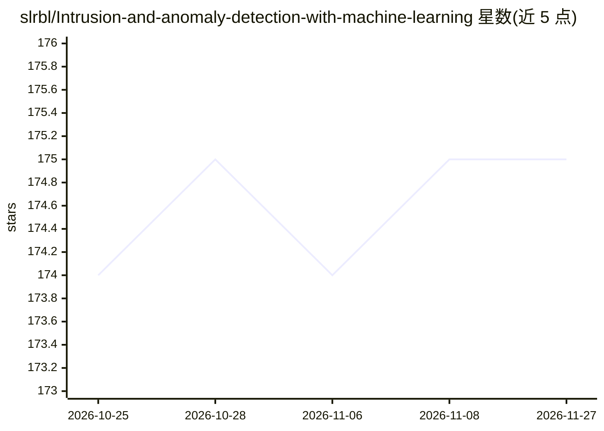

# slrbl/Intrusion-and-anomaly-detection-with-machine-learning

⭐ 175 · Ruby · MIT · 推送 2026-10-29 · [GitHub](https://github.com/slrbl/Intrusion-and-anomaly-detection-with-machine-learning) · 个人维护

**给 SOC 团队做应用日志攻击检测与 LLM 分析的工具**

Webhawk 是一个面向安全运营的日志攻击检测工具：将原始日志（如 Apache 访问日志、OS 进程统计）转为数值特征并做 PCA 降维，用 DBSCAN 无监督聚类识别离群点作为潜在攻击痕迹，检测结果通过 Web UI 供分析师查看并可通过内置 API 推送到现有 SOC 生态（如 SIEM）。检测完成后交由用户指定的 LLM（默认经 Ollama 运行 granite4 与 tev1 模型）生成分析与建议。生产部署依赖单台服务器上运行三个 Docker 服务，并在每个持有日志的端点部署 Python Agent。

## 筛选速览

| 维度 | 判定 | 备注 |
|---|---|---|
| AI 角色 | `ai-native` | 本体是模型或模型工具 |
| 许可风险 | `permissive` | MIT |
| 部署形态 | `self-host` | docker 或自建部署 |
| 模型依赖 | local-ok | 支持本地模型 |
| 硬件要求 | — | 无带数字的原话,不猜 |
| 安装摩擦 | `low` | 无编译、无系统依赖或容器化 |
| 成熟度 | — | 结构信号不足 |

## 能力要点

- PCA + DBSCAN 无监督聚类检测日志异常，无需预设规则
- 检测后由 Agentic AI 模式调用 LLM 生成分析与建议
- 提供 Web UI 管理检测结果及内置 API 对接 SIEM
- 端点 Agent 采集日志并经 API 传输到检测引擎

## 适用场景

- 对 Apache 访问日志做无规则攻击痕迹检测
- 在端点上部署 Agent 采集日志集中分析
- 把检测结果接入现有 SIEM/SOC 流程
- 检测异常 OS 进程行为

## 场景标签

`网络安全` · 领域:学习与行业

## 证据(README 行号)

> L11: Webhawk is an ML/AI powered detection tool designed to automatically identify attack traces in application logs (Eg
> L21: Once detections are complete, the results are sent to an LLM of your choice for in-depth analysis and actionable re
> L25: The tool is easy to deploy using Docker Compose, which simplifies the installation of the three main components: th

## 星数曲线

2026-10-25 174 → 2026-11-27 175（+1）

---
*卡片 v1 · prompt 1.4 · 生成 2026-11-27 · 置信度 high · 依据 README sha `11761a918288` · [字段定义](../../DATASET.md)*
