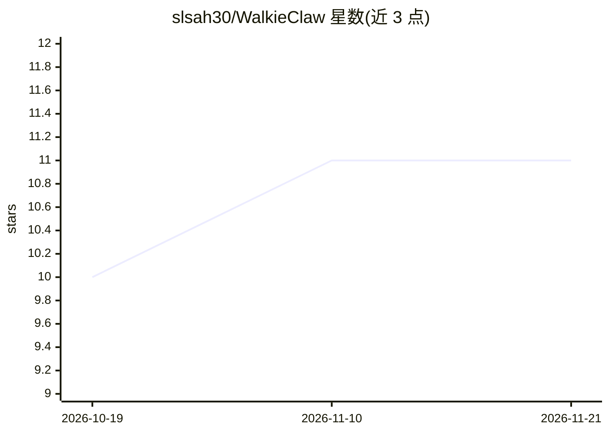

# slsah30/WalkieClaw

⭐ 11 · TypeScript · MIT · 推送 2026-09-06 · [GitHub](https://github.com/slsah30/WalkieClaw) · 个人维护

**可自建的 AI 对讲机：ESP32-S3 按键说话，语音问答**

基于 ESP32-S3 开发板（AIPI Lite，约 15 美元，内置麦克风、扬声器、LCD 与 LED）的开源硬件项目：按键录音后经 UDP 发送到 PC 或服务器上的桥接程序，由 faster-whisper 做语音识别、OpenClaw agent 生成回答、Edge TTS 合成语音回放，可随时按键打断。桥接提供 Node.js 本地版（GPU 加速）、Python VPS 版与 Docker 版三种部署；固件用 ESPHome 配置，首次设置通过设备自带热点与网页完成，无需改 YAML。

## 筛选速览

| 维度 | 判定 | 备注 |
|---|---|---|
| AI 角色 | `ai-native` | 本体是模型或模型工具 |
| 许可风险 | `permissive` | MIT |
| 部署形态 | `library` | 以包/库形式分发 |
| 模型依赖 | — | README 未给出锁定关系 |
| 硬件要求 | `cpu-ok` | |
| 安装摩擦 | `medium` | 含编译或系统依赖之一 |
| 成熟度 | — | 结构信号不足 |

## 能力要点

- 按键说话、语音回答的对讲机交互，支持播放中打断
- 三种桥接部署：Node.js 本地（GPU）、Python VPS、Docker
- 固件基于 ESPHome，首次配置经设备热点与 captive portal 完成
- 浏览器版 128x128 显示屏模拟器，支持调色与 YAML 导出

## 适用场景

- 自己动手组装一台桌面语音问答设备
- 在家庭 WiFi 或手机热点下随处使用语音助手
- 为 OpenClaw agent 配一个实体语音入口

## 场景标签

`语音 Agent` `语音识别` `语音合成` · 领域:对话与助手

## 证据(README 行号)

> L7: **A tiny AI walkie-talkie you can build yourself.**
> L70: **Requirements:** Node.js 18+, Python 3.10+, NVIDIA GPU (optional but recommended), OpenClaw (an open-source AI age
> L155: - GPU-accelerated speech recognition via faster-whisper (CUDA)

## 星数曲线

2026-10-19 10 → 2026-11-21 11（+1）

---
*卡片 v1 · prompt 1.4 · 生成 2026-11-18 · 置信度 high · 依据 README sha `85b999a7185a` · [字段定义](../../DATASET.md)*
