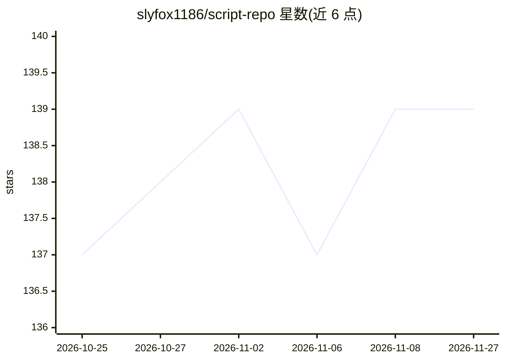

# slyfox1186/script-repo

⭐ 139 · Shell · MIT · 推送 2026-11-22 · [GitHub](https://github.com/slyfox1186/script-repo) · 个人维护

**面向 Windows/Linux 用户的自动化脚本集合仓库**

个人脚本仓库，收录 AutoHotkey、Batch、PowerShell、Python、Bash、VBS、Windows Registry、XML 等多种语言的工具脚本，覆盖 Linux 环境下一键安装与源码编译 GCC/Clang/FFmpeg/ImageMagick/OpenSSL/Rust 等软件、apt 镜像配置、shell 环境定制、deb 包离线下载、WSL2 内核更新、媒体播放器与 GParted 安装等场景。经 Arch/Debian/Ubuntu 测试，脚本通过 curl 远程命令或 git clone 方式使用。

## 筛选速览

| 维度 | 判定 | 备注 |
|---|---|---|
| AI 角色 | `ai-knowledge` | 知识聚合/清单类 |
| 许可风险 | `permissive` | MIT |
| 部署形态 | `desktop` | 安装包/桌面程序 |
| 模型依赖 | — | README 未给出锁定关系 |
| 硬件要求 | — | 无带数字的原话,不猜 |
| 安装摩擦 | `high` | 编译与系统依赖俱全 |
| 成熟度 | — | 结构信号不足 |

## 能力要点

- 覆盖 AHK/Batch/PowerShell/Python/Bash/VBS 等多语言脚本
- Linux 一键构建菜单与批量构建 GitHub 脚本命令
- 提供 GCC/Clang/FFmpeg/OpenSSL 等源码编译脚本
- apt 镜像配置、shell 环境定制、WSL2 内核更新等系统维护脚本

## 适用场景

- 在 Debian/Ubuntu 上一键安装或从源码编译常用开发工具
- 配置 apt 镜像源并定制 bash 环境
- 下载 deb 包用于离线安装或备份
- 更新 WSL2 内核与扩展 GParted 文件系统支持

## 场景标签

 · 领域:系统工具/自动化脚本

## 证据(README 行号)

> L3: Welcome to Sly's Script Repository! This collection is dedicated to sharing my favorite scripts for both Windows and
> L21: ### Purpose of This Repository
> L30: ### Linux Build Menu

## 星数曲线

2026-10-25 137 → 2026-11-27 139（+2）

---
*卡片 v1 · prompt 1.4 · 生成 2026-11-27 · 置信度 mid · 依据 README sha `c629e14962c5` · [字段定义](../../DATASET.md)*
