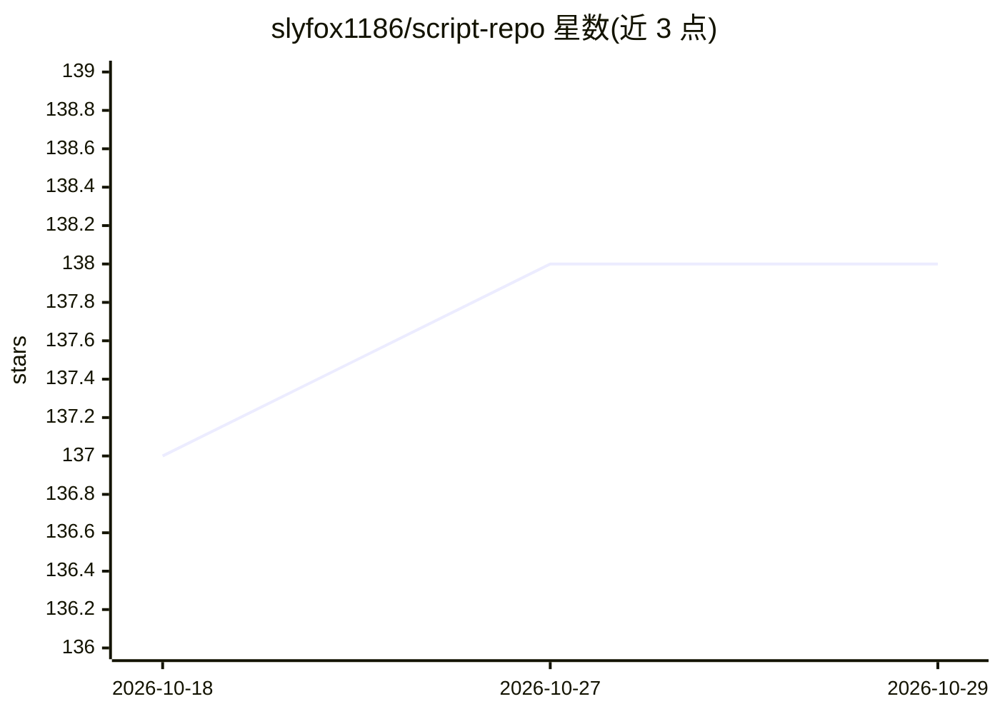

# slyfox1186/script-repo

⭐ 138 · Shell · MIT · 推送 2026-10-13 · [GitHub](https://github.com/slyfox1186/script-repo) · 个人维护

**多语言系统管理脚本合集：Linux/Windows 软件安装与自动化**

个人维护的 Windows/Linux 脚本仓库，涵盖 AutoHotkey、Batch、PowerShell、Python 3、Bash、VBS、Windows Registry、XML 等语言。功能以系统安装与自动化为主：一条命令安装 GCC/Clang/OpenSSL/ImageMagick/FFmpeg/Rust/Aria2 等软件，配置 apt 镜像、定制 shell 环境、下载 deb 包、更新 WSL2 内核等。README 提供各脚本的 curl/bash 一键运行命令，脚本在 Arch、Debian 12、Ubuntu 22.04 上测试。README 内容未涉及主题标签中的 machine-learning 相关功能。

## 筛选速览

| 维度 | 判定 | 备注 |
|---|---|---|
| AI 角色 | `ai-knowledge` | 知识聚合/清单类 |
| 许可风险 | `permissive` | MIT |
| 部署形态 | `desktop` | 安装包/桌面程序 |
| 模型依赖 | — | README 未给出锁定关系 |
| 硬件要求 | — | 无带数字的原话,不猜 |
| 安装摩擦 | `high` | 编译与系统依赖俱全 |
| 成熟度 | — | 结构信号不足 |

## 能力要点

- 8 种语言脚本，覆盖 Windows 与 Linux（Arch/Debian 12/Ubuntu 22.04 测试）
- 一键式 curl|bash 安装 GCC、Clang、OpenSSL、ImageMagick、7-Zip 等
- FFmpeg 源码编译脚本，可选包含 CUDA SDK 加速
- apt 镜像加速、shell 环境定制、WSL2 内核更新等系统维护脚本

## 适用场景

- 在 Debian/Ubuntu 上从源码安装最新版编译器与工具链
- 批量配置 Linux 系统环境（镜像、字体、终端、shell 配置）
- 下载 deb 包做离线安装或备份

## 场景标签

 · 领域:系统管理/开发工具

## 证据(README 行号)

> L5: ## Included Languages and Technologies
> L21: ### Purpose of This Repository

## 星数曲线

2026-10-18 137 → 2026-10-29 138（+1）

---
*卡片 v1 · prompt 1.4 · 生成 2026-10-22 · 置信度 low · 依据 README sha `c82cbcc23717` · [字段定义](../../DATASET.md)*
