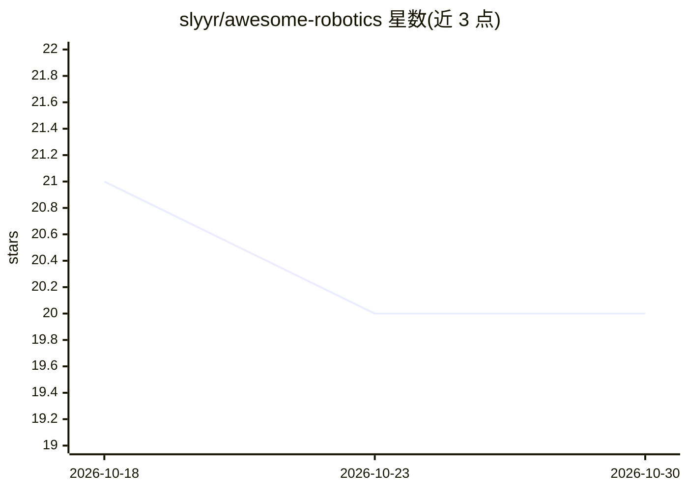

# slyyr/awesome-robotics

⭐ 20 · MIT · 推送 2026-10-29 · [GitHub](https://github.com/slyyr/awesome-robotics) · [官网](https://slyyr.github.io/awesome-robotics/) · 个人维护

**面向学习者的免费 AI 与机器人学资源策展清单**

一个精选资源清单仓库，收录学习 AI、机器人学、数学、物理、编程与工程相关主题的免费学习资料，覆盖课程、书籍、讲座、论文、教程与项目等类型。仓库声明不做链接堆砌，按 AI、机器人学、数学、物理、编程与工程、仿真、项目、指南等分类组织，并提供 AI 学习路径与机器人学学习路径作为入门起点。接受通过 CONTRIBUTING.md 提交新条目。

## 筛选速览

| 维度 | 判定 | 备注 |
|---|---|---|
| AI 角色 | `ai-knowledge` | 知识聚合/清单类 |
| 许可风险 | `permissive` | MIT |
| 部署形态 | `None` |  |
| 模型依赖 | — | README 未给出锁定关系 |
| 硬件要求 | — | 无带数字的原话,不猜 |
| 安装摩擦 | `low` | 无编译、无系统依赖或容器化 |
| 成熟度 | — | 结构信号不足 |

## 能力要点

- 免费学习资源策展，涵盖课程/书籍/讲座/论文/教程/项目
- 按 AI、机器人学、数学、物理、编程、仿真等 8 类组织
- 提供 AI 与机器人学两条学习路径
- 通过 CONTRIBUTING.md 接受社区贡献

## 适用场景

- 按主题查找免费的 AI 与机器人学学习资料
- 跟随学习路径从基础进入机器人学与 AI 领域
- 为工程项目查找仿真与实践项目资源

## 场景标签

`精选清单` · 领域:学习与行业

## 证据(README 行号)

> L3: A curated collection of genuinely useful **free resources for learning AI, robotics, mathematics, physics, programmi
> L11: - AI
> L12: - Robotics

## 星数曲线

2026-10-18 21 → 2026-10-30 20（-1）

---
*卡片 v1 · prompt 1.4 · 生成 2026-10-28 · 置信度 high · 依据 README sha `f4aee40e9a6b` · [字段定义](../../DATASET.md)*
