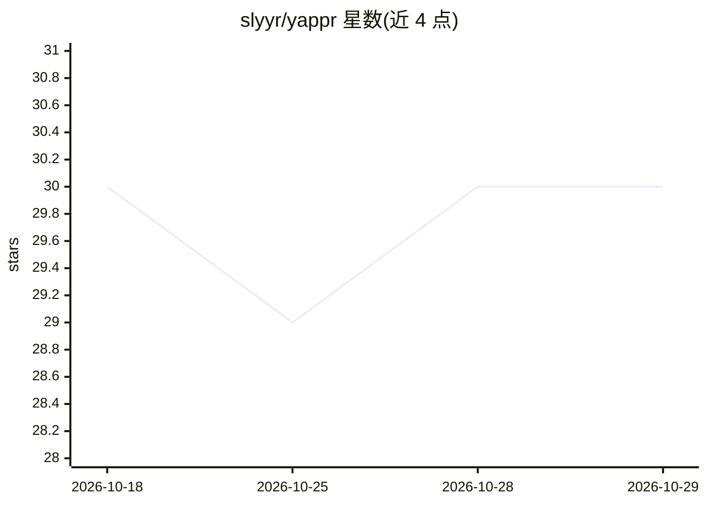

# slyyr/yappr

⭐ 30 · Python · 推送 2026-10-14 · [GitHub](https://github.com/slyyr/yappr) · 个人维护

**本地运行的 Python AI agent：工具调用+记忆+RAG**

基于 Python 与 Ollama 的本地 AI agent，通过本地 LLM（Qwen 2.5）驱动动态工具注册表，提供计算器、天气、时区、Tavily 联网搜索、SQLite 持久记忆、文档读取（TXT/MD/JSON/CSV/PDF/DOCX）与轻量 RAG 检索（分块、Ollama 嵌入、向量存储、相似度计算）。安装方式为 git clone 后运行 setup.sh（自动建虚拟环境、装依赖、拉取模型），需配置 Tavily API key。附带 pytest 自动化测试。

## 筛选速览

| 维度 | 判定 | 备注 |
|---|---|---|
| AI 角色 | `ai-native` | 本体是模型或模型工具 |
| 许可风险 | `none` | — |
| 部署形态 | `None` |  |
| 模型依赖 | local-ok | 支持本地模型 |
| 硬件要求 | — | 无带数字的原话,不猜 |
| 安装摩擦 | `low` | 无编译、无系统依赖或容器化 |
| 成熟度 | — | 结构信号不足 |

## 能力要点

- 动态工具注册表，工具与主 agent 解耦
- RAG 流水线含分块、索引、Ollama 嵌入与向量存储
- SQLite 持久记忆与 6 种文档格式处理
- setup.sh 自动化安装并拉取 Qwen 与嵌入模型

## 适用场景

- 本地运行一个能调用工具的对话助手
- 对本地文档做 RAG 检索问答
- 在无云端依赖的环境中使用带记忆的 agent

## 场景标签

`聊天机器人` `RAG` `Agent 框架` · 领域:Agent 开发

## 证据(README 行号)

> L3: > A locally running AI agent built with Python and Ollama that can use tools, search the web, remember information, 
> L29: **User → Yappr → Local LLM → Tool Registry → Tools → Results → Local LLM → Response**

## 星数曲线

2026-10-18 30 → 2026-10-29 30（+0）

---
*卡片 v1 · prompt 1.4 · 生成 2026-10-26 · 置信度 high · 依据 README sha `f70bfa504ab7` · [字段定义](../../DATASET.md)*
