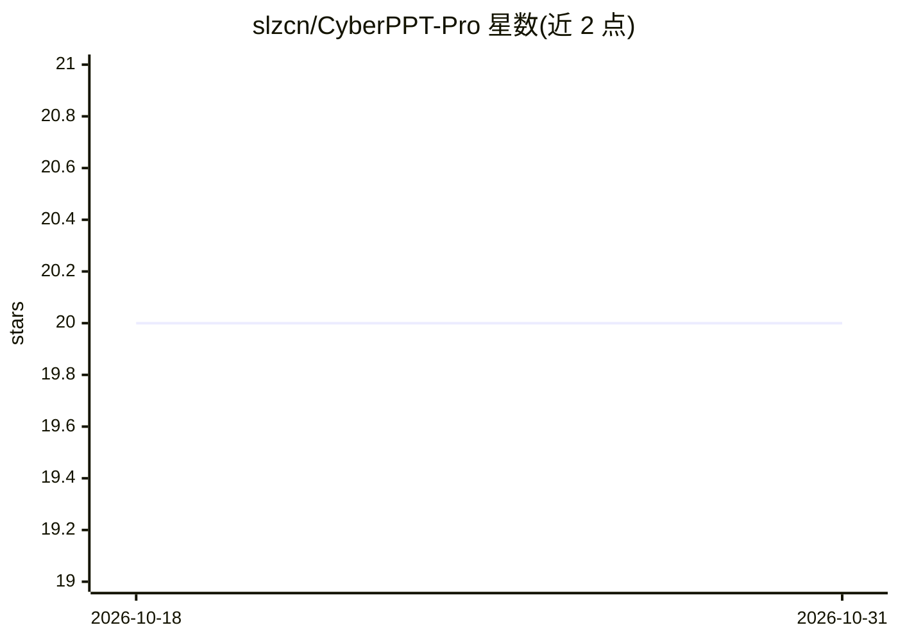

# slzcn/CyberPPT-Pro

⭐ 20 · MIT · 推送 2026-07-07 · [GitHub](https://github.com/slzcn/CyberPPT-Pro) · [官网](https://slzcn.github.io/CyberPPT-Pro/examples/sample-preview.html) · 个人维护 · 中文 README

**面向 Claude/Codex 的咨询风格 PPT 生成 Skill**

基于 CyberPPT 重构的 agent 技能包：core 目录承载平台无关核心逻辑，claude/ 与 codex/ 目录各提供轻适配层。流程为摄取输入（文档数据/旧PPT截图还原/一句话需求）→ 证据表与故事线 → HTML 样张选风格 → HTML 全稿预览 → 生成原生可编辑 PPTX → 三层 QA。提供 12 种视觉风格与 10 个场景内容框架，确认门数量按复杂度评分自动增减。安装方式为将 SKILL.md 目录上传至 claude.ai 或放入 Claude Code 技能目录，Codex 侧通过 AGENTS.md 引用。

## 筛选速览

| 维度 | 判定 | 备注 |
|---|---|---|
| AI 角色 | `ai-native` | 本体是模型或模型工具 |
| 许可风险 | `permissive` | MIT |
| 部署形态 | `None` |  |
| 模型依赖 | locked-api |  |
| 硬件要求 | — | 无带数字的原话,不猜 |
| 安装摩擦 | `low` | 无编译、无系统依赖或容器化 |
| 成熟度 | — | 结构信号不足 |

## 能力要点

- 默认输出全原生可编辑 PPTX（文本/形状/原生图表/表格）
- HTML 样张零图像生成依赖
- 三类混合输入：文档数据 / 旧PPT与截图还原 / 一句话需求
- 12 视觉风格 + 10 场景内容框架，自适应确认门

## 适用场景

- 让 Claude 或 Codex 生成咨询风格的演示文稿
- 将旧 PPT 或截图还原为可编辑的新版 PPT
- 按行业研究/尽调/增长等场景框架组织演示内容

## 场景标签

`AI 写作` · 领域:内容生成

## 证据(README 行号)

> L3: 咨询风格 PPT 生成 Skill，基于 CyberPPT 重构。
> L37: 摄取 ─► 证据表+故事线(SCR/场景框架) ─► HTML样张选风格 ─► HTML预览全稿 ─► 原生PPTX ─► 三层QA ─► 交付

## 星数曲线

2026-10-18 20 → 2026-10-31 20（+0）

---
*卡片 v1 · prompt 1.4 · 生成 2026-10-28 · 置信度 high · 依据 README sha `c2fef1a6563a` · [字段定义](../../DATASET.md)*
