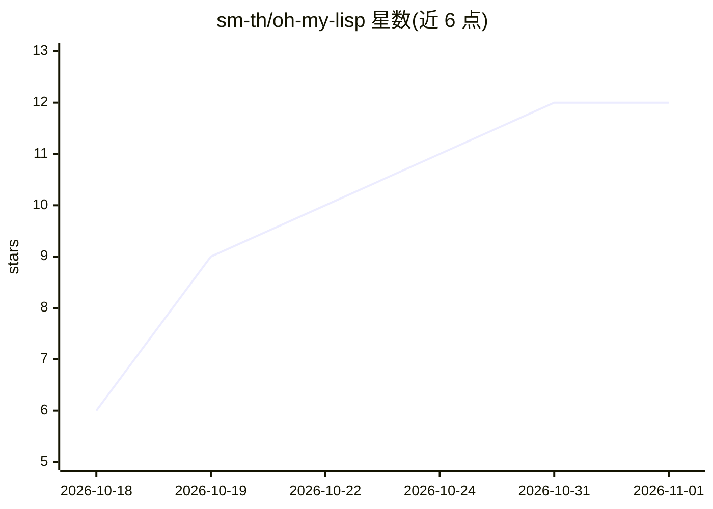

# sm-th/oh-my-lisp

⭐ 12 · Clojure · 推送 2026-10-06 · [GitHub](https://github.com/sm-th/oh-my-lisp) · [官网](https://oml.sh) · 个人维护

**Clojure 编写、可运行中修改的最小化编码 agent**

用 babashka/Clojure 实现的约 1.5k 行编码 agent，提供 read/write/edit/bash 工具与自有 agent loop。特点是每一步、每个工具和斜杠命令均为命名函数，可在运行中通过 defn、advise!、init 文件、/eval 或 nREPL 重定义。通过 Agent Client Protocol 以 Toad、Zed、Emacs agent-shell 作为 UI，可连接任意 OpenAI 兼容 Chat Completions 端点。按章节构建，用于理解编码 agent 的内部原理，与 pi 逐步对比。

## 筛选速览

| 维度 | 判定 | 备注 |
|---|---|---|
| AI 角色 | `ai-ecosystem` | LLM/agent 周边工具 |
| 许可风险 | `none` | — |
| 部署形态 | `None` |  |
| 模型依赖 | — | README 未给出锁定关系 |
| 硬件要求 | — | 无带数字的原话,不猜 |
| 安装摩擦 | `low` | 无编译、无系统依赖或容器化 |
| 成熟度 | — | 结构信号不足 |

## 能力要点

- 约 1.5k 行自有 agent loop，含 read/write/edit/bash 工具
- 运行中重定义任意步骤/工具（defn/advise!/nREPL）
- 支持 Agent Client Protocol，以 Toad/Zed/Emacs 为 UI
- 任意 OpenAI 兼容 Chat Completions 端点

## 适用场景

- 需要一个可边运行边改造的编码 agent
- 通过逐章阅读源码学习编码 agent 的实现机制
- 在 Zed/Emacs/Toad 中接入自定义 agent

## 场景标签

`编码 Agent` `教程课程` · 领域:编码与开发

## 证据(README 行号)

> L3: A minimal coding agent in Clojure (babashka) that you change while it runs.
> L8: - Its own agent loop in about 1.5k lines; tools `read`, `write`, `edit`, `bash`.

## 星数曲线

2026-10-18 6 → 2026-11-01 12（+6）

---
*卡片 v1 · prompt 1.4 · 生成 2026-11-01 · 置信度 high · 依据 README sha `59530a194aa7` · [字段定义](../../DATASET.md)*
