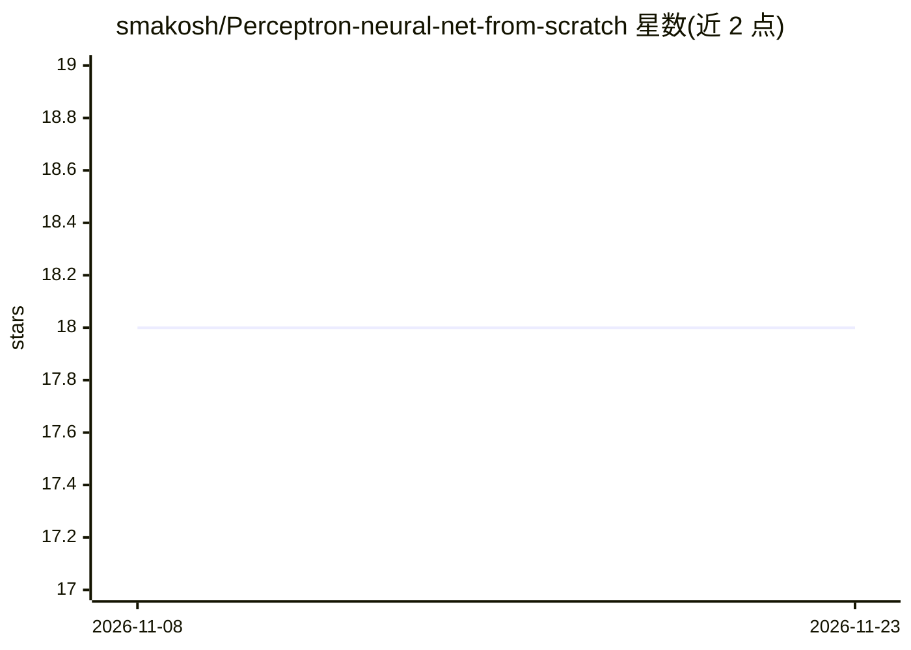

# smakosh/Perceptron-neural-net-from-scratch

⭐ 18 · Jupyter Notebook · 推送 2026-11-06 · [GitHub](https://github.com/smakosh/Perceptron-neural-net-from-scratch) · [官网](https://smakosh.com/build-your-perceptron) · 个人维护

**从零实现的单个感知机教学项目，含鸢尾花分类**

教学性质的 Jupyter Notebook 仓库：用 NumPy 从零实现单个神经元（sigmoid 激活、梯度下降训练），另一版本使用 scikit-learn 实现；附带一个可基于 Kaggle 鸢尾花数据训练的分类器。依赖通过 pip 逐个安装（numpy/matplotlib/jupyter/pandas/scikit-learn），无打包发布、无命令行入口。作者附有讲解文章与 Kaggle notebook 链接，面向想理解神经网络数学原理的学习者。

## 筛选速览

| 维度 | 判定 | 备注 |
|---|---|---|
| AI 角色 | `ai-native` | 本体是模型或模型工具 |
| 许可风险 | `none` | — |
| 部署形态 | `library` | 以包/库形式分发 |
| 模型依赖 | — | README 未给出锁定关系 |
| 硬件要求 | — | 无带数字的原话,不猜 |
| 安装摩擦 | `low` | 无编译、无系统依赖或容器化 |
| 成熟度 | — | 结构信号不足 |

## 能力要点

- 从零实现的单神经元（sigmoid + 梯度下降）notebook
- 另附 scikit-learn 实现版本作对照
- 可训练的鸢尾花分类器，使用 Kaggle 真实数据

## 适用场景

- 学习感知机的数学原理与梯度下降过程
- 对照手写实现与 scikit-learn 实现的差异
- 在鸢尾花数据集上运行入门分类实验

## 场景标签

`教程课程` · 领域:学习与行业

## 证据(README 行号)

> L2: A single neuron (sigmoid activation, trained with gradient descent) built from scratch to help you understand the ma
> L6: Also an Iris flowers classifier that you can train using a real data from Kaggle !

## 星数曲线

2026-11-08 18 → 2026-11-23 18（+0）

---
*卡片 v1 · prompt 1.4 · 生成 2026-11-18 · 置信度 high · 依据 README sha `60d62848dad3` · [字段定义](../../DATASET.md)*
