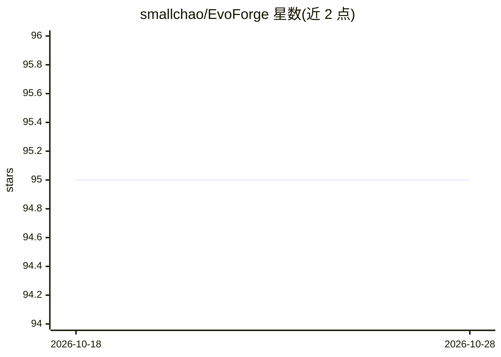

# smallchao/EvoForge

⭐ 95 · 推送 2026-08-23 · [GitHub](https://github.com/smallchao/EvoForge) · [官网](https://evoforge.cc) · 个人维护

**具备记忆与技能沉淀能力的桌面智能体工作台**

基于 Rust 和 Tauri 构建的本地优先桌面智能体工作台，覆盖 Windows 与 macOS。内置浏览器、终端、文件与 Git 面板，按“目标→计划→执行验证→交付→蒸馏”循环运行：任务后自动将可复用动作序列沉淀为技能、偏好写入记忆，并由内置策展器定期合并去重。支持三种沙箱级别、全文搜索历史会话、通过官方 CLI 一键接入 GitHub/Cloudflare/Supabase 及任意 MCP 服务器。仓库仅托管发布与问题跟踪，声明非开源（非商业许可），通过 GitHub Releases 分发安装包。

## 筛选速览

| 维度 | 判定 | 备注 |
|---|---|---|
| AI 角色 | `ai-native` | 本体是模型或模型工具 |
| 许可风险 | `none` | — |
| 部署形态 | `desktop` | 安装包/桌面程序 |
| 模型依赖 | — | README 未给出锁定关系 |
| 硬件要求 | — | 无带数字的原话,不猜 |
| 安装摩擦 | `low` | 无编译、无系统依赖或容器化 |
| 成熟度 | — | 结构信号不足 |

## 能力要点

- 任务后自动蒸馏技能并写入记忆，内置策展器定期合并去双
- 浏览器/终端/文件/Git 一体化面板与目标模式（令牌预算内自主执行）
- 三种沙箱级别、破坏性操作强制确认与审计日志
- MCP 服务器（stdio/远程 HTTP/OAuth）接入与官方 CLI 一键连接

## 适用场景

- 让智能体长期积累项目经验，避免每次任务从零开始
- 在一个窗口内完成浏览器、终端、文件与 Git 的操作任务
- 托管长时间运行的目标任务并审计其执行过程

## 场景标签

`GUI 自动化` `浏览器自动化` · 领域:效率与自动化

## 证据(README 行号)

> L3:  Most AI agents start every day from zero. EvoForge remembers everything it learned yesterday.
> L29:     B --> C([Execute & Verify <small>browser · terminal · files · git</small>])
> L35: After every task, EvoForge **reflects on the run**: action sequences worth repeating are distilled into **skills**,

## 星数曲线

2026-10-18 95 → 2026-10-28 95（+0）

---
*卡片 v1 · prompt 1.4 · 生成 2026-10-23 · 置信度 high · 依据 README sha `3a80e863d784` · [字段定义](../../DATASET.md)*
