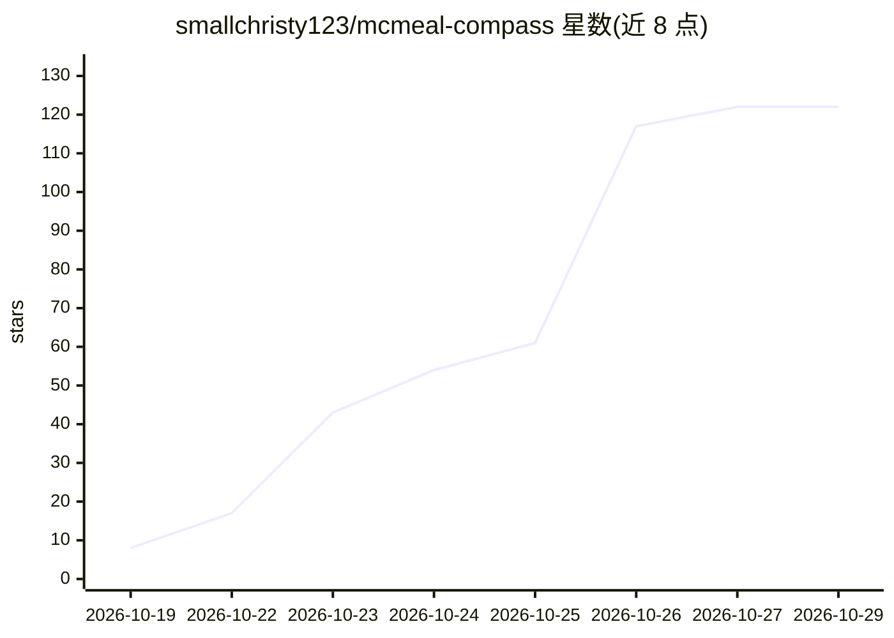

# smallchristy123/mcmeal-compass

⭐ 122 · TypeScript · MIT · 推送 2026-10-19 · [GitHub](https://github.com/smallchristy123/mcmeal-compass) · 个人维护 · 中文 README

**基于麦当劳中国官方 MCP 的营养搭配与官方计价 CLI 工具**

命令行工具（TypeScript/Node），面向麦当劳点餐场景：通过麦当劳中国官方 MCP 查询门店菜单与官方营养数据，套餐逐件展开匹配营养并求和（组件命中 87.6%），输出均衡/蛋白质/预算优先三方案对比，支持配件替换重算价格。价格采用四态标注（official/official-unverified/menu-adjusted-unverified/menu），取不到官方报价时如实标注而非填 0。附 SKILL.md 可装载到 MCP 客户端用自然语言交互；离线快照可跑无需 Token。限制：不提供下单能力（REAL_ORDERING_ENABLED=false），不做医疗推荐与过敏安全保证，modern 协议路径未经真实端点验证。

## 筛选速览

| 维度 | 判定 | 备注 |
|---|---|---|
| AI 角色 | `ai-native` | 本体是模型或模型工具 |
| 许可风险 | `permissive` | MIT |
| 部署形态 | `library` | 以包/库形式分发 |
| 模型依赖 | — | README 未给出锁定关系 |
| 硬件要求 | — | 无带数字的原话,不猜 |
| 安装摩擦 | `low` | 无编译、无系统依赖或容器化 |
| 成熟度 | — | 结构信号不足 |

## 能力要点

- 套餐逐件展开匹配官方营养再求和（组件命中 87.6%）
- 价源四态标注，未知项不伪装为 0，仅 official 态可称「已核」
- SKILL.md 装载入口，可在 MCP 客户端中自然语言交互
- 离线快照可复现运行，无需 Token

## 适用场景

- 输入预算和饮食偏好，比较门店当前可售餐品的三种方案
- 套餐内替换饮料/配菜并重算营养与价格
- 核对每个营养数值与金额的官方来源

## 场景标签

`数据分析` · 领域:效率与自动化

## 证据(README 行号)

> L5: 基于**麦当劳中国官方 MCP**（Model Context Protocol）的「**可解释营养搭配 × 官方计价核价 × 下单前安全闸门**」命令行工具。
> L54: |模型自说自话|**结构化规则负责数值和约束，LLM 仅负责理解意图及清晰表达**|
> L166: 3. 在客户端中启用 `mcd-mcp`，打开本 Skill，用自然语言描述你的一餐需求。例如：

## 星数曲线

2026-10-19 8 → 2026-10-29 122（+114）

---
*卡片 v1 · prompt 1.4 · 生成 2026-10-24 · 置信度 high · 依据 README sha `47e56720aece` · [字段定义](../../DATASET.md)*
