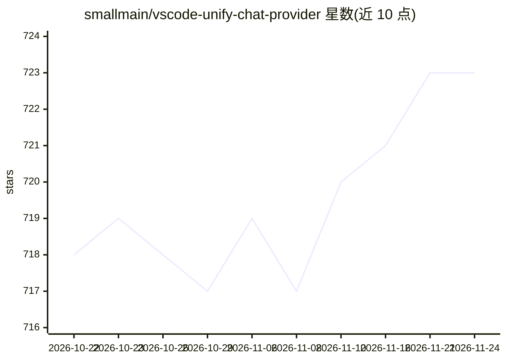

# smallmain/vscode-unify-chat-provider

⭐ 721 · TypeScript · MIT · 推送 2026-11-11 · [GitHub](https://github.com/smallmain/vscode-unify-chat-provider) · 个人维护 · 中文 README

**把多家 LLM API 接入 VS Code Copilot Chat 的扩展**

一个 VS Code 扩展，通过 Language Model API 将多种 LLM API 格式（OpenAI Chat Completions、OpenAI Responses、Anthropic Messages、Ollama Chat、Gemini）统一接入 GitHub Copilot Chat 使用。提供可视化界面配置供应商与模型，支持一键配置 45+ 主流供应商、自动拉取官方模型列表、从其他工具一键迁移配置、Base64/JSON/URL 导入导出，并附带 FIM/NES 代码补全（5 种算法）与 commit message 生成功能。要求 VS Code 1.115.0+，部分功能依赖启用实验性 Proposed API。

## 筛选速览

| 维度 | 判定 | 备注 |
|---|---|---|
| AI 角色 | `ai-ecosystem` | LLM/agent 周边工具 |
| 许可风险 | `permissive` | MIT |
| 部署形态 | `None` |  |
| 模型依赖 | local-ok | 支持本地模型 |
| 硬件要求 | — | 无带数字的原话,不猜 |
| 安装摩擦 | `low` | 无编译、无系统依赖或容器化 |
| 成熟度 | — | 结构信号不足 |

## 能力要点

- 支持 5 种 LLM API 格式，适配 45+ 主流供应商
- 一键使用 Claude Code、Gemini CLI、GitHub Copilot 等账户额度
- 5 种代码补全算法（含 Copilot 核心实现的复刻）
- 配置可视化管理和多格式导入导出

## 适用场景

- 在 Copilot Chat 中使用自己配置的各供应商模型
- 整合 Claude Code、ChatGPT 等订阅的账户额度到 VS Code
- 用自定义模型替换默认的代码补全与 commit message 生成
- 从其他 AI 编程工具一键迁移模型配置

## 场景标签

`模型网关` · 领域:Agent 开发

## 证据(README 行号)

> L3: Integrate multiple LLM API providers into VS Code's GitHub Copilot Chat using the Language Model API.
> L12: - 🔌 **Perfect Compatibility**: Supports all major LLM API formats (OpenAI Chat Completions, OpenAI Responses, Anthr
> L24: - Search for Unify Chat Provider in the VS Code Extension Marketplace and install it.

## 星数曲线

2026-10-22 718 → 2026-11-24 723（+5）

---
*卡片 v1 · prompt 1.4 · 生成 2026-11-24 · 置信度 high · 依据 README sha `06e8357dc4fe` · [字段定义](../../DATASET.md)*
