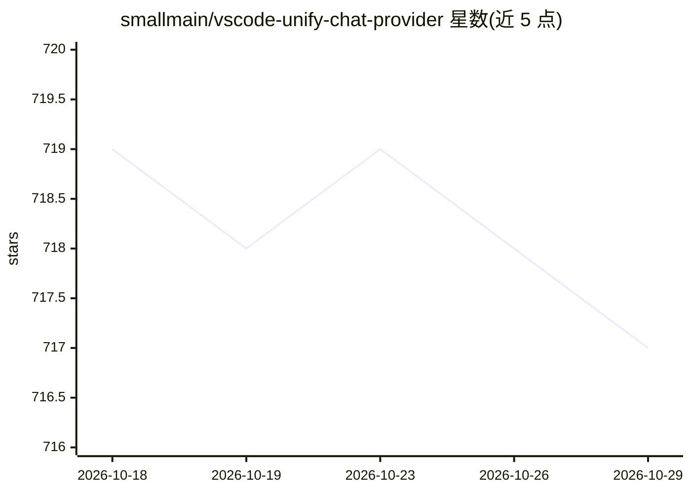

# smallmain/vscode-unify-chat-provider

⭐ 717 · TypeScript · MIT · 推送 2026-10-09 · [GitHub](https://github.com/smallmain/vscode-unify-chat-provider) · 个人维护 · 中文 README

**把多家 LLM API 接入 VS Code Copilot Chat 的扩展**

VS Code 扩展，通过 Language Model API 将多个 LLM API 提供商接入 GitHub Copilot Chat。支持 OpenAI Chat Completions/Responses、Anthropic Messages、Ollama Chat、Gemini 等 API 格式，提供 45+ 提供商一键配置、官方模型列表自动同步、从其他应用/扩展一键迁移配置。附加功能包括 FIM/NES 代码补全（Simple/Zed/Inception/Mistral 算法）与 commit message 生成。需 VS Code 1.115.0+，部分功能依赖实验性 Proposed API。

## 筛选速览

| 维度 | 判定 | 备注 |
|---|---|---|
| AI 角色 | `ai-ecosystem` | LLM/agent 周边工具 |
| 许可风险 | `permissive` | MIT |
| 部署形态 | `None` |  |
| 模型依赖 | local-ok | 支持本地模型 |
| 硬件要求 | — | 无带数字的原话,不猜 |
| 安装摩擦 | `low` | 无编译、无系统依赖或容器化 |
| 成熟度 | — | 结构信号不足 |

## 能力要点

- 45+ 提供商一键配置与官方模型列表自动同步
- 支持 OpenAI/Anthropic/Ollama/Gemini 等主要 API 格式
- 多种 FIM/NES 代码补全算法（含 Copilot 与 Zed 实现复刻）
- 一键复用 Claude Code/Gemini CLI/Codex/Zed 等账户额度

## 适用场景

- 在 Copilot Chat 中使用自有 API 或其他厂商模型
- 把已在其他工具配好的模型配置迁移到 VS Code
- 用自定义模型驱动代码补全与 commit message 生成

## 场景标签

`模型网关` · 领域:Agent 开发

## 证据(README 行号)

> L3: Integrate multiple LLM API providers into VS Code's GitHub Copilot Chat using the Language Model API.
> L12: - 🔌 **Perfect Compatibility**: Supports all major LLM API formats (OpenAI Chat Completions, OpenAI Responses, Anthr

## 星数曲线

2026-10-18 719 → 2026-10-29 717（-2）

---
*卡片 v1 · prompt 1.4 · 生成 2026-10-21 · 置信度 high · 依据 README sha `d12c0dd6567d` · [字段定义](../../DATASET.md)*
