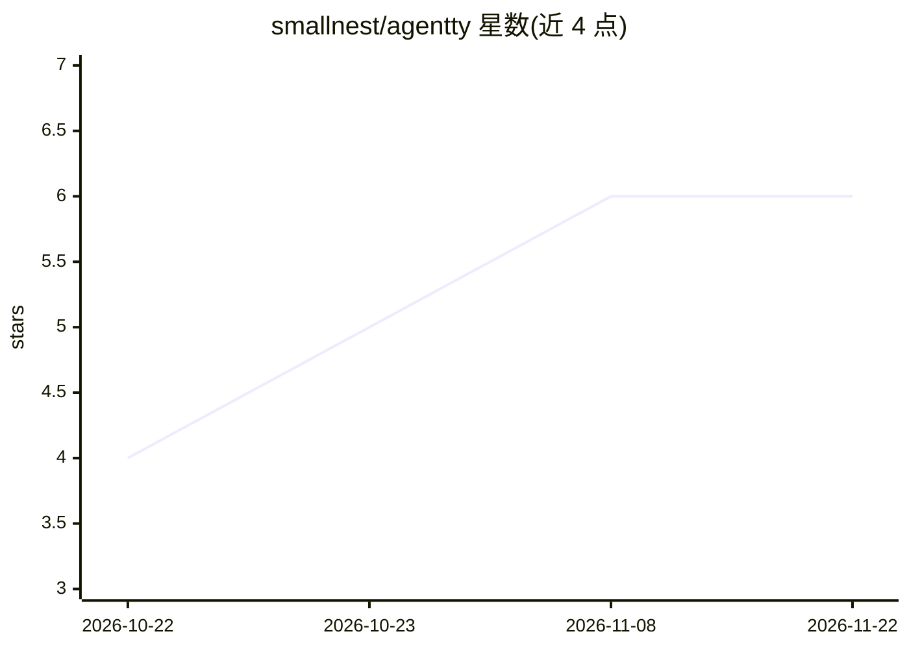

# smallnest/agentty

⭐ 6 · Go · MIT · 推送 2026-11-18 · [GitHub](https://github.com/smallnest/agentty) · 个人维护

**在本地以浏览器终端形式访问 coding-agent CLI 的守护进程**

Go 编写的本地优先守护进程：在 PTY 中启动 Claude Code、Codex、OpenCode 等终端 agent，通过 WebSocket 向浏览器提供 xterm.js 终端界面。每个会话由独立 host 进程持有 PTY，守护进程重启不中断 agent，重连时回放屏幕。内置配对认证（恢复令牌、一次性配对码、可撤销设备凭据）、TLS、LAN 自动发现与可选 relay。提供安装脚本、预编译二进制、go install 与源码构建四种安装方式。

## 筛选速览

| 维度 | 判定 | 备注 |
|---|---|---|
| AI 角色 | `ai-ecosystem` | LLM/agent 周边工具 |
| 许可风险 | `permissive` | MIT |
| 部署形态 | `library` | 以包/库形式分发 |
| 模型依赖 | — | README 未给出锁定关系 |
| 硬件要求 | — | 无带数字的原话,不猜 |
| 安装摩擦 | `medium` | 含编译或系统依赖之一 |
| 成熟度 | `idea` | |

## 能力要点

- 支持 28 种内置 coding-agent 及任意 shell，可用 AGENTTY_AGENTS 自定义
- 会话持久化：detached host 持有 PTY，守护进程重启后回放屏幕
- 配对式认证：256 位恢复令牌、一次性配对码、独立可撤销设备凭据
- 单二进制内嵌 Web UI 与字体，支持 TLS 与可选 relay

## 适用场景

- 在手机或另一台电脑的浏览器里操作本机运行的 coding agent
- 远程开发时保持 agent 会话在守护进程重启后继续存活
- 局域网内通过 HTTPS/WSS 安全访问多个终端会话

## 场景标签

 · 领域:开发者工具/远程终端

## 证据(README 行号)

> L11: agentty is a local-first daemon for Claude Code, Codex, OpenCode, Pi, and any
> L61:    agentty daemon ──unix socket──▶ agentty host ──PTY──▶ claude / codex / opencode / pi

## 星数曲线

2026-10-22 4 → 2026-11-22 6（+2）

---
*卡片 v1 · prompt 1.4 · 生成 2026-11-20 · 置信度 high · 依据 README sha `31163f3d5e5c` · [字段定义](../../DATASET.md)*
