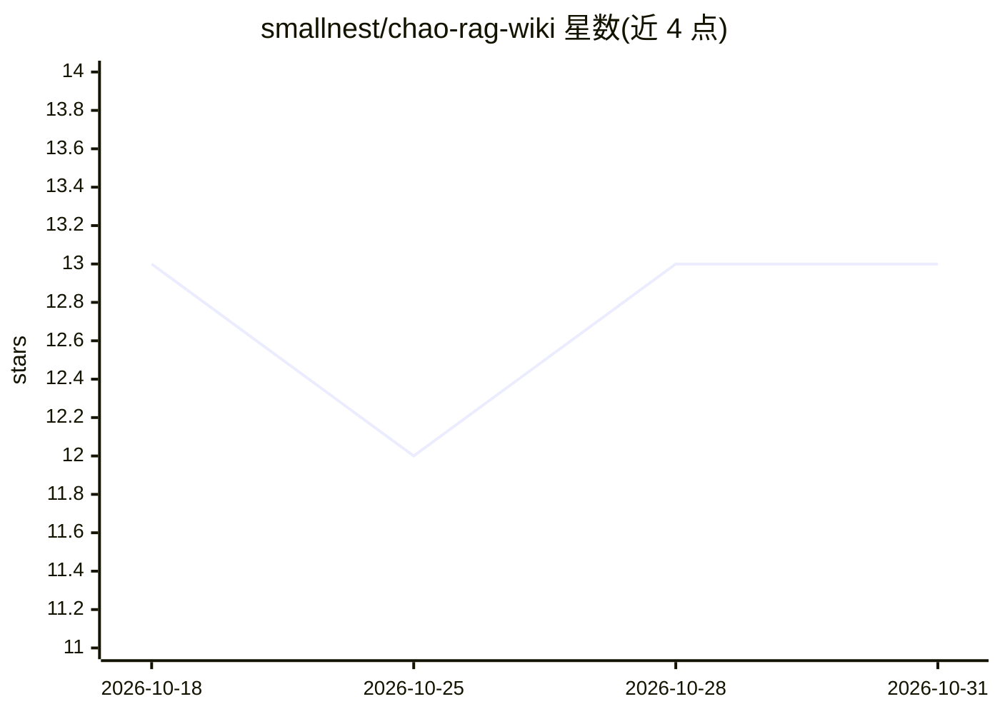

# smallnest/chao-rag-wiki

⭐ 13 · Python · MIT · 推送 2026-07-08 · [GitHub](https://github.com/smallnest/chao-rag-wiki) · 个人维护 · 中文 README

**Claude Code 的本地文档 RAG 技能：向量+BM25 混合检索问答**

面向 Claude Code 的 RAG 技能：对本地 raw/ 目录的 Markdown 语料按标题切分（约 1200 字符）、经任意 OpenAI 兼容 /embeddings 端点嵌入（默认 Qianfan bge-large-zh），用 turbovec 量化索引构建语义检索；查询时以稠密向量与 CJK 感知的 BM25 经 Reciprocal Rank Fusion 融合，可选 LLM rerank，由 agent 读取检索片段合成带引用的回答。支持 --update 增量索引，raw/ 目录不被修改。需 Python 3 与嵌入 API key。

## 筛选速览

| 维度 | 判定 | 备注 |
|---|---|---|
| AI 角色 | `ai-ecosystem` | LLM/agent 周边工具 |
| 许可风险 | `permissive` | MIT |
| 部署形态 | `library` | 以包/库形式分发 |
| 模型依赖 | local-ok | 支持本地模型 |
| 硬件要求 | — | 无带数字的原话,不猜 |
| 安装摩擦 | `low` | 无编译、无系统依赖或容器化 |
| 成熟度 | — | 结构信号不足 |

## 能力要点

- 稠密检索（turbovec TurboQuantIndex）与 CJK 感知 BM25 经 RRF 融合
- 嵌入端点 provider 无关：OpenAI 兼容接口经环境变量配置
- --update 增量索引仅重嵌入新增/变更文件，--check 可预览不产生嵌入调用
- 查询结果含来源映射，agent 合成带引用回答

## 适用场景

- 让 Claude Code 基于我的 Obsidian 笔记库回答问题
- 为持续增长的本地 Markdown 文档建立可增量更新的检索索引
- 切换不同嵌入提供商（Qianfan/OpenAI/Voyage/vLLM）构建本地知识问答

## 场景标签

`RAG` `文档问答` · 领域:知识与检索

## 证据(README 行号)

> L3: A RAG (retrieval-augmented generation) skill for Claude Code. It builds a
> L81: 3. The agent reads the retrieved chunks (use `--json`) and synthesizes a cited

## 星数曲线

2026-10-18 13 → 2026-10-31 13（+0）

---
*卡片 v1 · prompt 1.4 · 生成 2026-10-31 · 置信度 high · 依据 README sha `4c75107a135e` · [字段定义](../../DATASET.md)*
