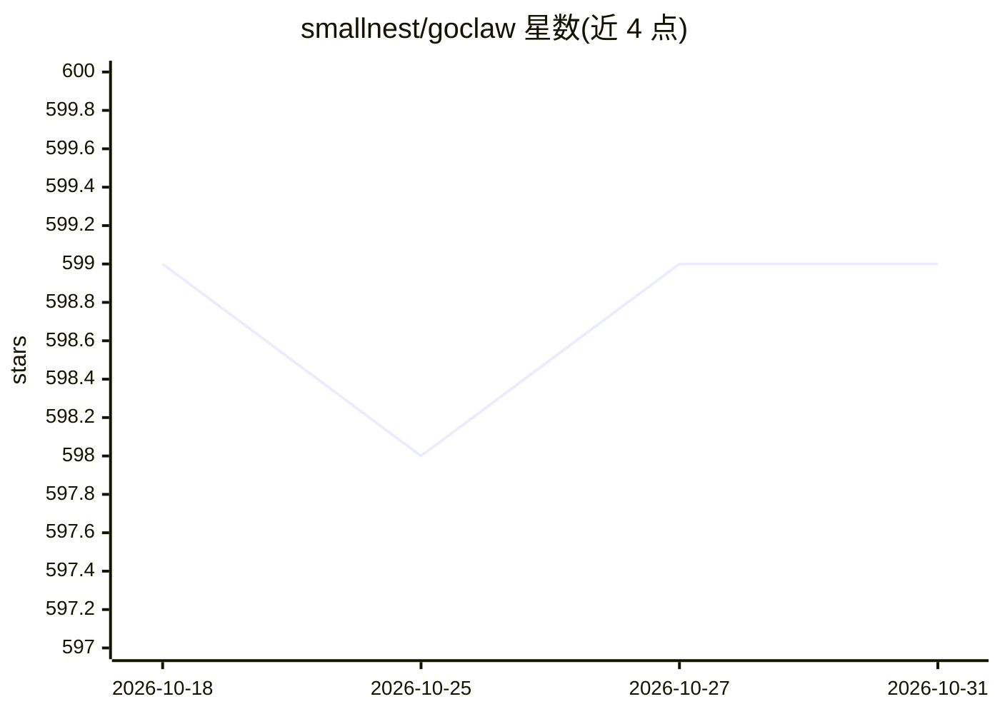

# smallnest/goclaw

⭐ 599 · Go · MIT · 推送 2026-03-27 · [GitHub](https://github.com/smallnest/goclaw) · 个人维护 · 中文 README

**Go 语言实现的 AI Agent 框架，含技能系统与多渠道接入**

用 Go 编写的 AI Agent 框架，功能包括工具系统（文件/Shell/Web/浏览器，支持 Docker 沙箱与权限控制）、兼容 OpenClaw 与 AgentSkills 规范的技能系统（SKILL.md 编写、环境准入检测）、JSONL 持久化会话、15 种消息渠道（Telegram/微信/飞书/钉钉等）、Cron 调度、内置向量数据库或 QMD 记忆后端。多 LLM 提供商支持（OpenAI/Anthropic/OpenRouter/百度千帆）并支持故障转移。提供 CLI、WebSocket Gateway Dashboard 和 Tauri 桌面壳，通过源码克隆构建运行。

## 筛选速览

| 维度 | 判定 | 备注 |
|---|---|---|
| AI 角色 | `ai-ecosystem` | LLM/agent 周边工具 |
| 许可风险 | `permissive` | MIT |
| 部署形态 | `None` |  |
| 模型依赖 | locked-api |  |
| 硬件要求 | — | 无带数字的原话,不猜 |
| 安装摩擦 | `low` | 无编译、无系统依赖或容器化 |
| 成熟度 | — | 结构信号不足 |

## 能力要点

- 兼容 OpenClaw 技能生态，SKILL.md 编写技能并自动检测环境准入
- 15 种消息渠道含微信/飞书/QQ/企业微信/钉钉，支持多账号实例
- 工具系统支持 Docker 沙箱、denied_cmds 命令黑名单与权限控制
- 多 LLM 提供商配置与故障转移，内置向量数据库/QMD 记忆后端

## 适用场景

- 搭建接入微信/Telegram/飞书等渠道的个人 AI 助手
- 复用 OpenClaw 技能生态扩展 Agent 能力
- 通过 Dashboard 或 CLI 管理会话、定时任务与浏览器自动化

## 场景标签

`Agent 框架` · 领域:Agent 开发

## 证据(README 行号)

> L3: Go 语言版本的 OpenClaw - 一个功能强大的 AI Agent 框架。
> L9: - 🛠️ **完整的工具系统**：FileSystem、Shell、Web、Browser，支持 Docker 沙箱与权限控制
> L281: 1. **Agent Loop** - 主循环，处理消息、调用工具、生成响应

## 星数曲线

2026-10-18 599 → 2026-10-31 599（+0）

---
*卡片 v1 · prompt 1.4 · 生成 2026-10-21 · 置信度 high · 依据 README sha `bcc0fb76ffa8` · [字段定义](../../DATASET.md)*
