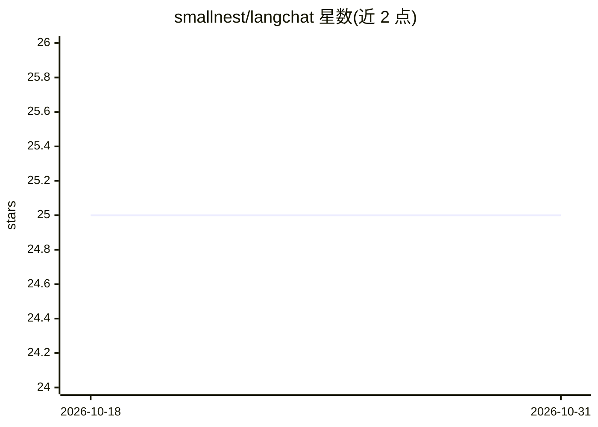

# smallnest/langchat

⭐ 25 · HTML · Apache-2.0 · 推送 2025-12-23 · [GitHub](https://github.com/smallnest/langchat) · [官网](https://chat.rpcx.io) · 个人维护 · 中文 README

**基于 Go 与 LangGraphGo 的智能聊天应用框架**

用 Go 实现的聊天智能体应用框架，基于 LangGraphGo 构建对话智能体，提供多会话管理、SSE 流式响应、上下文记忆、LLM 驱动的工具选择、Skills 技能包与 MCP 协议工具集成。面向需要在框架上专注业务逻辑开发的开发者，内置 JWT 认证、用户管理、速率限制、Prometheus 监控与健康检查等企业功能，提供 Web UI、JSON/YAML 配置热重载与本地 JSON 会话持久化。支持 OpenAI、Azure OpenAI、百度千帆与 Ollama 等模型来源。

## 筛选速览

| 维度 | 判定 | 备注 |
|---|---|---|
| AI 角色 | `ai-ecosystem` | LLM/agent 周边工具 |
| 许可风险 | `permissive` | Apache-2.0 |
| 部署形态 | `self-host` | docker 或自建部署 |
| 模型依赖 | local-ok | 支持本地模型 |
| 硬件要求 | — | 无带数字的原话,不猜 |
| 安装摩擦 | `low` | 无编译、无系统依赖或容器化 |
| 成熟度 | — | 结构信号不足 |

## 能力要点

- 基于 LangGraphGo 的对话智能体与 SSE 流式响应
- Skills 技能包系统与 MCP 协议工具集成，LLM 自动选择工具
- 内置 JWT 认证、角色权限、速率限制与 Prometheus 监控
- 支持 OpenAI、Azure OpenAI、百度千帆、Ollama 多种 LLM 提供商

## 适用场景

- 在现成框架上快速开发带智能体的聊天应用
- 搭建支持多用户、多会话和工具调用的对话服务
- 通过 Docker 或 Makefile 部署带监控与认证的聊天平台

## 场景标签

`Agent 框架` · 领域:Agent 开发

## 证据(README 行号)

> L3: 一个基于 Go 和 LangGraphGo 的现代化智能聊天应用框架，集成了AI智能体、多会话管理、工具支持和本地持久化存储。
> L11: - **AI 智能体**: 基于 LangGraphGo 的先进对话智能体

## 星数曲线

2026-10-18 25 → 2026-10-31 25（+0）

---
*卡片 v1 · prompt 1.4 · 生成 2026-10-26 · 置信度 high · 依据 README sha `706ef47f77b1` · [字段定义](../../DATASET.md)*
