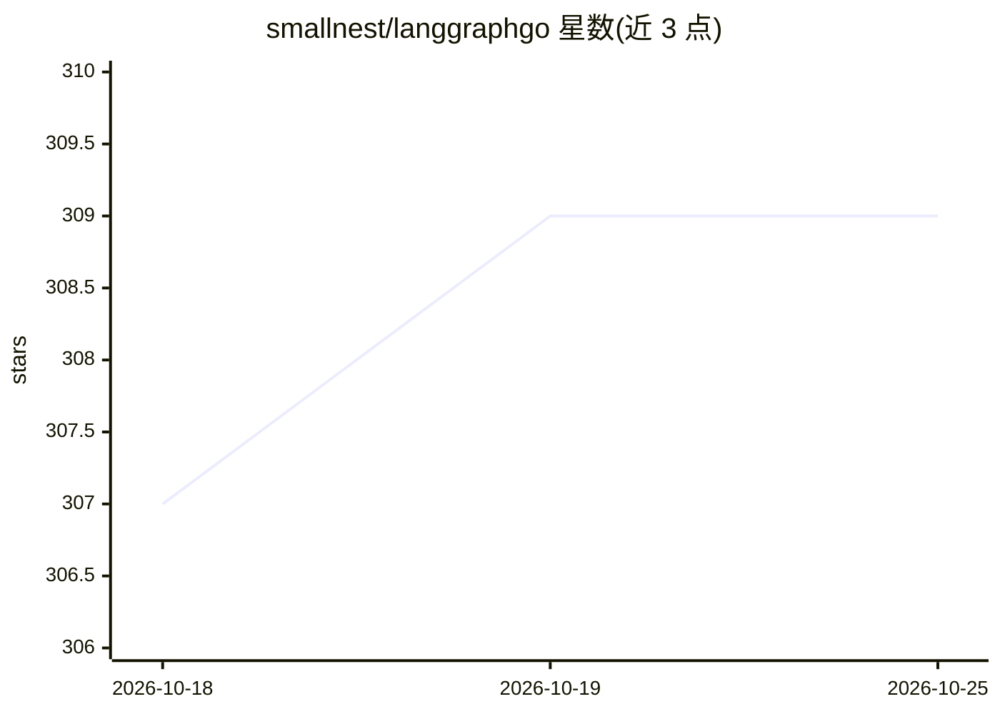

# smallnest/langgraphgo

⭐ 309 · Go · MIT · 推送 2026-07-16 · [GitHub](https://github.com/smallnest/langgraphgo) · [官网](https://lango.rpcx.io) · 个人维护 · 中文 README

**Go 语言的 LangGraph 风格 agent 工作流框架**

从 paulnegz/langgraphgo 分支而来的 Go 库，目标是与 Python LangGraph 功能对齐：提供并行节点执行、泛型状态图、Redis/Postgres/SQLite/文件检查点持久化、人机回环中断恢复、子图组合、多模式流式输出，以及 ReAct/Supervisor 等预置 agent 工厂。内置 nativeopenai/openairesponses 及豆包、通义千问 provider，不依赖 langchaingo 但提供薄适配层。附带 90+ 示例，含 RAG 管线与 MCP 集成。MIT 许可。

## 筛选速览

| 维度 | 判定 | 备注 |
|---|---|---|
| AI 角色 | `ai-ecosystem` | LLM/agent 周边工具 |
| 许可风险 | `permissive` | MIT |
| 部署形态 | `None` |  |
| 模型依赖 | — | README 未给出锁定关系 |
| 硬件要求 | — | 无带数字的原话,不猜 |
| 安装摩擦 | `low` | 无编译、无系统依赖或容器化 |
| 成熟度 | — | 结构信号不足 |

## 能力要点

- 并行节点执行与线程安全状态合并
- Redis/Postgres/SQLite/文件四种检查点持久化与状态恢复
- ReAct/Supervisor 等预置 agent 工厂与人机回环
- 内置 nativeopenai/openairesponses/doubao/qwen provider，附 90+ 示例

## 适用场景

- 用 Go 构建带状态持久化的 LLM agent 工作流
- 搭建需要人工审批中断的多步 agent 流程
- 复用 RAG、多 agent 监督等示例快速起步

## 场景标签

`Agent 框架` `多智能体` · 领域:Agent 开发

## 证据(README 行号)

> L13: > This fork aims for **feature parity with the Python LangGraph library**, adding support for parallel execution, p
> L34: - **Core Runtime**:

## 星数曲线

2026-10-18 307 → 2026-10-25 309（+2）

---
*卡片 v1 · prompt 1.4 · 生成 2026-10-21 · 置信度 high · 依据 README sha `eca44af4625f` · [字段定义](../../DATASET.md)*
