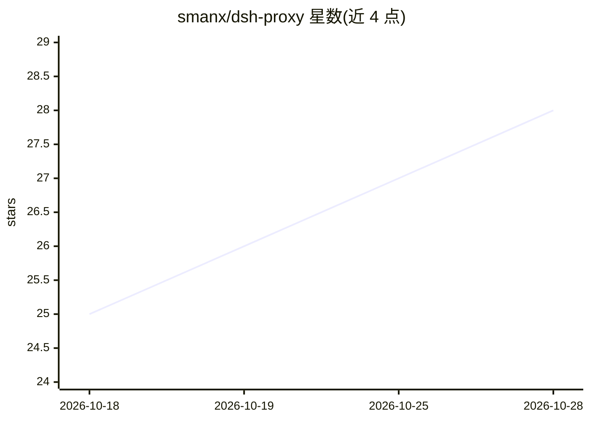

# smanx/dsh-proxy

⭐ 28 · JavaScript · 推送 2026-10-20 · [GitHub](https://github.com/smanx/dsh-proxy) · [官网](https://github.com/smanx/dsh-proxy/releases) · 个人维护 · 中文 README

**把本地 DSH 服务暴露到局域网的反向代理（HTTP+WS）**

面向 DSH（DeepSeek Harness）用户的双形态反向代理：插件版随 `dsh web` 启停、带设置页面；独立可执行版有 Go（6-7 MB，标准库实现）与 Node.js SEA 打包（83-119 MB）两个等价单文件版本。核心机制包括 HTTP+WebSocket 全协议转发、Basic Auth（含 WS 握手统一校验）、Origin 对齐与 Host 改写以通过 DSH `/api` 同源校验、`crypto.randomUUID` polyfill 注入、可选免 token 首次访问（会移除 DSH 自身 token 校验，需与用户名密码搭配）。支持交互式配置记忆与 CLI 免交互参数，5 平台构建产物由 CI 自动发布。

## 筛选速览

| 维度 | 判定 | 备注 |
|---|---|---|
| AI 角色 | `ai-ecosystem` | LLM/agent 周边工具 |
| 许可风险 | `none` | — |
| 部署形态 | `desktop` | 安装包/桌面程序 |
| 模型依赖 | — | README 未给出锁定关系 |
| 硬件要求 | — | 无带数字的原话,不猜 |
| 安装摩擦 | `low` | 无编译、无系统依赖或容器化 |
| 成熟度 | — | 结构信号不足 |

## 能力要点

- HTTP + WebSocket 反向代理，LAN 访问 DSH 本地 3080 端口
- 插件版随 `dsh web` 启停，带设置页面（状态/端口/凭据）
- Go 单文件版 6-7 MB（标准库 httputil.ReverseProxy）与 Node SEA 版两个等价实现
- 免交互 CLI 参数与 config.json 配置记忆，支持计划任务

## 适用场景

- 在局域网其他设备上访问本机运行的 DSH 服务
- 为局域网暴露的 DSH 加 Basic Auth 访问控制
- 无需常驻独立进程，以插件方式随 dsh web 托管代理

## 场景标签

 · 领域:网络代理/AI 工具配套

## 证据(README 行号)

> L5: HTTP + WebSocket 反向代理：把局域网端口转发到本地 DSH 服务 `127.0.0.1:3080`。
> L10: **推荐 DSH（DeepSeek Harness）用户使用**：把代理作为插件装进 web profile，**随 `dsh web` 启停**，无需单独进程、无需下载可执行文件，带完整设置页面。

## 星数曲线

2026-10-18 25 → 2026-10-28 28（+3）

---
*卡片 v1 · prompt 1.4 · 生成 2026-10-26 · 置信度 mid · 依据 README sha `9457503b4a3a` · [字段定义](../../DATASET.md)*
