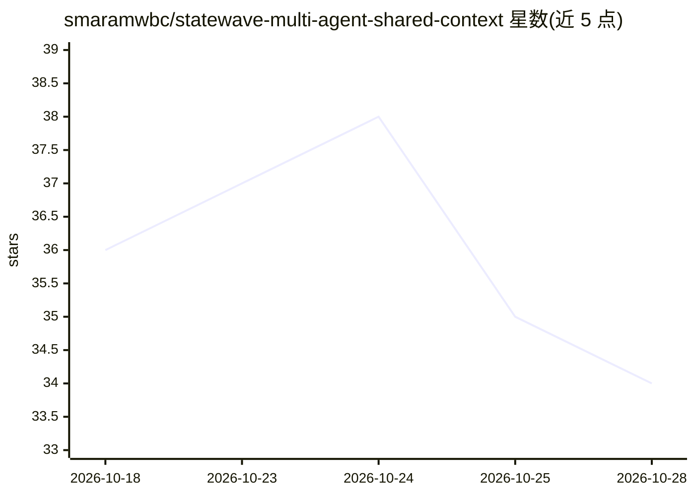

# smaramwbc/statewave-multi-agent-shared-context

⭐ 34 · Python · Apache-2.0 · 推送 2026-07-28 · [GitHub](https://github.com/smaramwbc/statewave-multi-agent-shared-context) · [官网](https://statewave.ai) · 个人维护

**演示共享上下文层防止并行 Agent 冲突的三角色 CLI 示例**

Statewave 生态的示例仓库：用 Planner/Coder/Reviewer 三个 Python CLI Agent 模拟软件开发任务，对比 naive 消息传递与共享 Statewave subject 两条流水线，展示并行 Agent 通过 episode→compile→memory 链在行动前读取共享决策以避免上下文冲突。LLM 调用经 LiteLLM 适配任意提供商（默认 Groq），需先本地自托管启动 Statewave（Docker 或 npx），并附 timeline_inspector 输出可审计时间线及 CrewAI/Claude Agent SDK 集成示例。面向构建多 Agent 系统的开发者。

## 筛选速览

| 维度 | 判定 | 备注 |
|---|---|---|
| AI 角色 | `ai-ecosystem` | LLM/agent 周边工具 |
| 许可风险 | `permissive` | Apache-2.0 |
| 部署形态 | `library` | 以包/库形式分发 |
| 模型依赖 | — | README 未给出锁定关系 |
| 硬件要求 | — | 无带数字的原话,不猜 |
| 安装摩擦 | `low` | 无编译、无系统依赖或容器化 |
| 成熟度 | — | 结构信号不足 |

## 能力要点

- 同一任务运行 naive（消息传递）与 statewave（共享 subject）两条对比流水线
- episode→compile→memory 三层数据模型，Agent 行动前读取已编译记忆
- timeline_inspector.py 输出全链路按时间排序的审计轨迹
- 提供 CrewAI / Claude Agent SDK 集成示例，两个调用点接入任意框架

## 适用场景

- 观察并行 Agent 因缺少共享上下文而产生冲突的复现与修复对比
- 为自己的多 Agent 框架接入 SharedContext 协调原语
- 本地自托管体验 Statewave 记忆运行时的完整链路

## 场景标签

`多智能体` `Agent 记忆` · 领域:Agent 开发

## 证据(README 行号)

> L10: > **Part of Statewave** — the open-source memory runtime for AI agents.
> L28: Statewave gives every agent in the fleet a shared **subject** (the run ID). Decisions are written as **episodes** a
> L61: A three-agent Python CLI running a simulated software development task:

## 星数曲线

2026-10-18 36 → 2026-10-28 34（-2）

---
*卡片 v1 · prompt 1.4 · 生成 2026-10-25 · 置信度 mid · 依据 README sha `36a6308dba58` · [字段定义](../../DATASET.md)*
