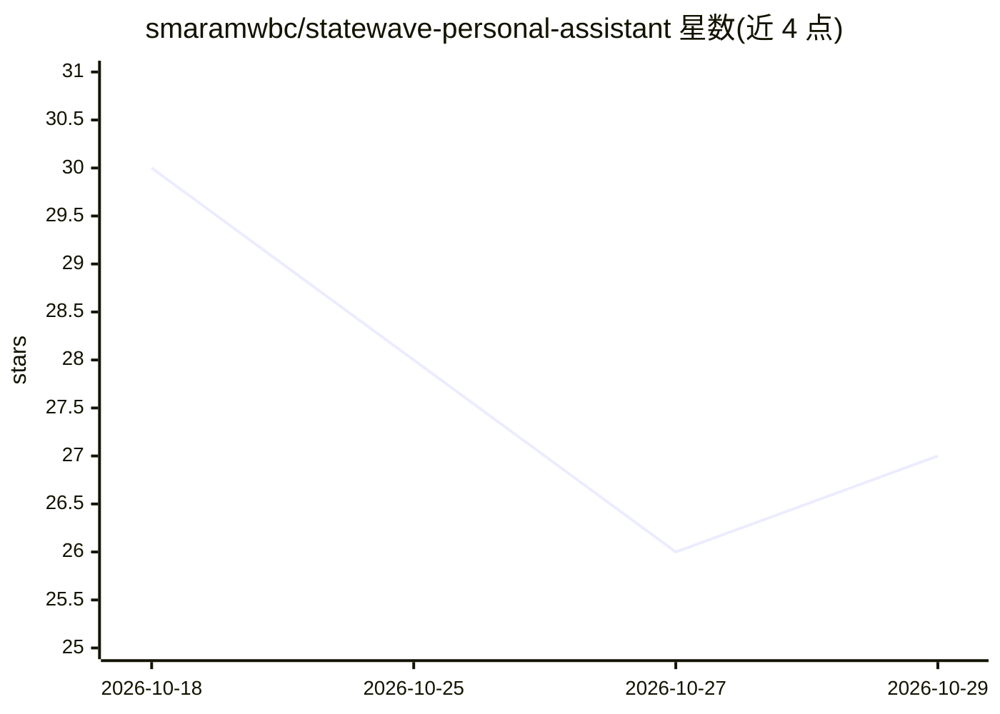

# smaramwbc/statewave-personal-assistant

⭐ 27 · Python · Apache-2.0 · 推送 2026-07-28 · [GitHub](https://github.com/smaramwbc/statewave-personal-assistant) · [官网](https://statewave.ai) · 组织维护

**Statewave 记忆集成的 FastAPI 参考应用：跨会话持久记忆**

演示如何为 Python 聊天应用接入 Statewave 记忆运行时的 FastAPI 参考实现：每轮对话前调用 get_context 获取按相关性排序、受 token 预算约束的上下文，调用 LLM 后通过 record_episode 记录回合，由 Statewave 编译为结构化记忆事实（profile_fact/procedure/episode_summary/artifact_ref）。提供 Web 界面与四个 CLI 命令（compare/inspect/budget/chat），内置两名演示用户的种子数据。面向开发者，需自托管 Statewave 服务器（Postgres + pgvector），LLM 走 OpenAI 兼容 API。

## 筛选速览

| 维度 | 判定 | 备注 |
|---|---|---|
| AI 角色 | `ai-ecosystem` | LLM/agent 周边工具 |
| 许可风险 | `permissive` | Apache-2.0 |
| 部署形态 | `desktop` | 安装包/桌面程序 |
| 模型依赖 | — | README 未给出锁定关系 |
| 硬件要求 | — | 无带数字的原话,不猜 |
| 安装摩擦 | `low` | 无编译、无系统依赖或容器化 |
| 成熟度 | — | 结构信号不足 |

## 能力要点

- 每轮对话用 get_context / record_episode 两次 HTTP 调用包裹 LLM 调用
- 记忆事实按类型与置信度排序，在 token 预算内返回可直接注入的字符串
- 提供 compare/inspect/budget/chat 四个 CLI 命令与可视化记忆面板
- 支持任意 OpenAI 兼容 LLM 提供方（OpenAI/Azure/本地 Ollama 等）

## 适用场景

- 给现有 Python 聊天应用添加跨会话持久记忆
- 对比有记忆与无记忆助手的回答差异
- 观察 token 预算下记忆事实的取舍过程

## 场景标签

`Agent 记忆` · 领域:Agent 开发

## 证据(README 行号)

> L12: A working reference implementation that shows how to add **persistent, cross-session memory** to any Python chat ap
> L103: The integration surface is two API calls: `get_context` before the LLM call and `record_episode` after. That is th

## 星数曲线

2026-10-18 30 → 2026-10-29 27（-3）

---
*卡片 v1 · prompt 1.4 · 生成 2026-10-26 · 置信度 mid · 依据 README sha `773d5809153a` · [字段定义](../../DATASET.md)*
