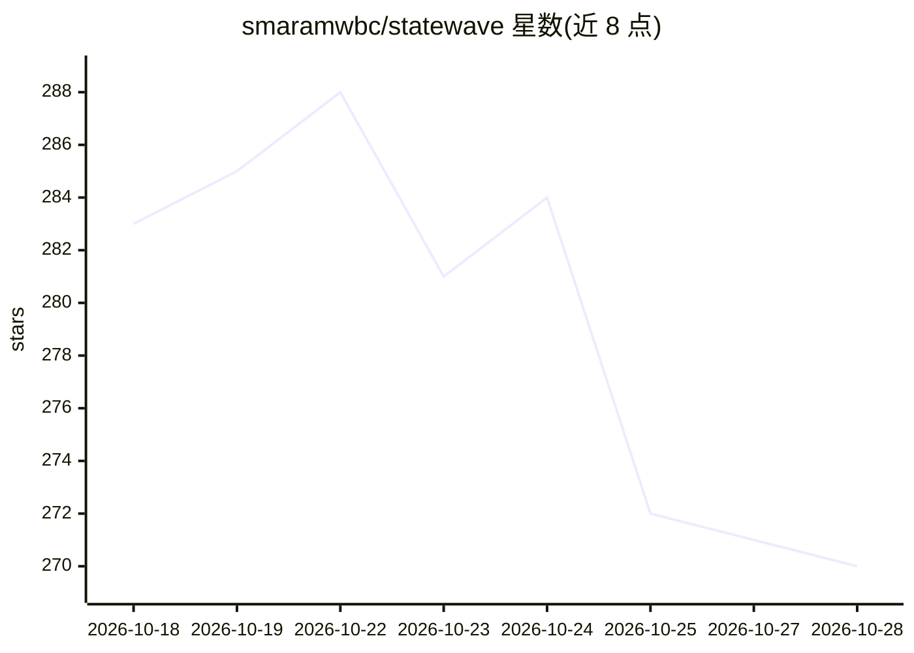

# smaramwbc/statewave

⭐ 270 · Python · Apache-2.0 · 推送 2026-10-24 · [GitHub](https://github.com/smaramwbc/statewave) · [官网](https://statewave.ai) · 组织维护

**面向 AI agent 的开源记忆运行时：可复现、带溯源的上下文包**

自托管的 agent 记忆基础设施：以 append-only episodes 摄取原始事件，按 subject 变化编译为带置信分与溯源的类型化记忆，再按需组装成排序、token 限制的确定性上下文包供提示词使用；支持敏感度标签策略引擎、多租户隔离、区域锁定与连接器（GitHub/Slack/Notion 等）。默认启发式编译器完全本地运行、无需 GPU，LLM 编译器与嵌入可选接任意 LiteLLM 提供商。部署于 Postgres+pgvector，提供 Python/TypeScript SDK 与 REST API。声明非聊天框架、非向量库、非 RAG 管道。

## 筛选速览

| 维度 | 判定 | 备注 |
|---|---|---|
| AI 角色 | `ai-ecosystem` | LLM/agent 周边工具 |
| 许可风险 | `permissive` | Apache-2.0 |
| 部署形态 | `self-host` | docker 或自建部署 |
| 模型依赖 | local-ok | 支持本地模型 |
| 硬件要求 | `cpu-ok` | |
| 安装摩擦 | `low` | 无编译、无系统依赖或容器化 |
| 成熟度 | — | 结构信号不足 |

## 能力要点

- 编译式确定性上下文包：同一 subject 同一时点重复查询产出相同字节
- 每条记忆溯源到源 episodes，回执内容哈希且 ULID 可寻址
- 默认启发式编译器完全本地，API 进程 CPU-only 无需 GPU
- YAML 声明式敏感度策略引擎与多租户区域锁定
- MCP/GitHub/Slack/Notion/Zendesk 等连接器生态

## 适用场景

- 让客服 agent 跨会话记住回头客的偏好与历史
- 长周期编码 agent 在多会话间保留技术栈与架构决策
- 为合规需求追踪每条记忆来源并按 subject 删除数据

## 场景标签

`Agent 记忆` · 领域:Agent 开发

## 证据(README 行号)

> L11: Statewave is the open-source memory runtime that gives AI agents reproducible, provenance-tagged context — without 
> L38: Statewave is **not** a chatbot framework, a vector database, a RAG pipeline, or a hosted service. It is infrastruct
> L164: |LLM provider (compiler)|Any of 100+ LiteLLM-supported providers — OpenAI, Anthropic, Azure, Bedrock, Ollama, Cohe

## 星数曲线

2026-10-18 283 → 2026-10-28 270（-13）

---
*卡片 v1 · prompt 1.4 · 生成 2026-10-22 · 置信度 high · 依据 README sha `1713fced4275` · [字段定义](../../DATASET.md)*
