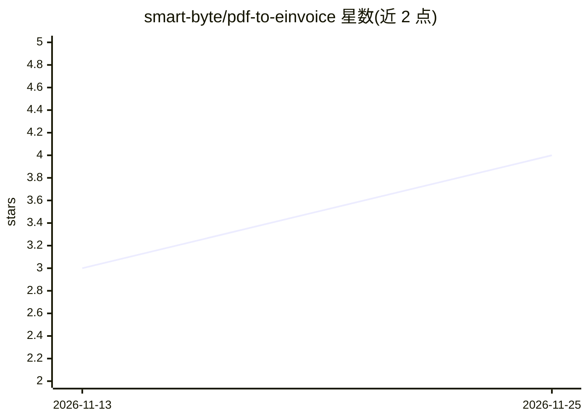

# smart-byte/pdf-to-einvoice

⭐ 4 · TypeScript · MIT · 推送 2026-11-22 · [GitHub](https://github.com/smart-byte/pdf-to-einvoice) · [官网](https://pdf-to-einvoice.app) · 个人维护

**把现有发票 PDF 转成 EN 16931 电子发票，本地运行不上传**

将已有发票 PDF 转为符合 EN 16931 的 ZUGFeRD/Factur-X 混合发票（数据以 factur-x.xml 附着、PDF 转 PDF/A-3，版面不重绘），或输出 XRechnung XML。读取基于规则模式匹配，可选浏览器内小语言模型（WebGPU）补全未识别字段，并用 keepWhatThePdfShows 丢弃 PDF 上不存在的值。提供浏览器应用、npm 包、CLI 与 MCP server 四种形态，全部本地运行，不上传发票内容；CI 用 veraPDF 与官方规则集校验生成结果。

## 筛选速览

| 维度 | 判定 | 备注 |
|---|---|---|
| AI 角色 | `ai-enhanced` | 去掉 AI 部分产品仍成立 |
| 许可风险 | `permissive` | MIT |
| 部署形态 | `library` | 以包/库形式分发 |
| 模型依赖 | — | README 未给出锁定关系 |
| 硬件要求 | — | 无带数字的原话,不猜 |
| 安装摩擦 | `low` | 无编译、无系统依赖或容器化 |
| 成熟度 | — | 结构信号不足 |

## 能力要点

- PDF 版面不重绘，发票数据以 XML 附着并转为 PDF/A-3
- 读取以模式匹配为主，可选浏览器内 WebGPU 小模型补全
- 提供 CLI、TypeScript 库、浏览器应用与 MCP server 四种形态
- 内置字段/合计校验，支持 7 类 VAT 类别与 XRechnung 3.0

## 适用场景

- 把 Word 或开票工具生成的 PDF 批量补上电子发票 XML
- 向德国公共机构提交 XRechnung 格式发票
- 让 AI 助手通过 MCP 读发票、检查并生成电子发票文件
- 本地处理含敏感数据的发票，不经过第三方服务器

## 场景标签

`文档解析` · 领域:知识与检索

## 证据(README 行号)

> L20: - **Nothing is uploaded.** The web app works in your browser; the library and the command line tool run on your
> L36: Reading works by pattern matching, without any AI. On request a small language model fills in what the patterns did
> L125: The MCP server lets an AI assistant do the whole job: read the PDF, fill in the data, show you what is missing, an

## 星数曲线

2026-11-13 3 → 2026-11-25 4（+1）

---
*卡片 v1 · prompt 1.4 · 生成 2026-11-21 · 置信度 high · 依据 README sha `92337c18f76b` · [字段定义](../../DATASET.md)*
